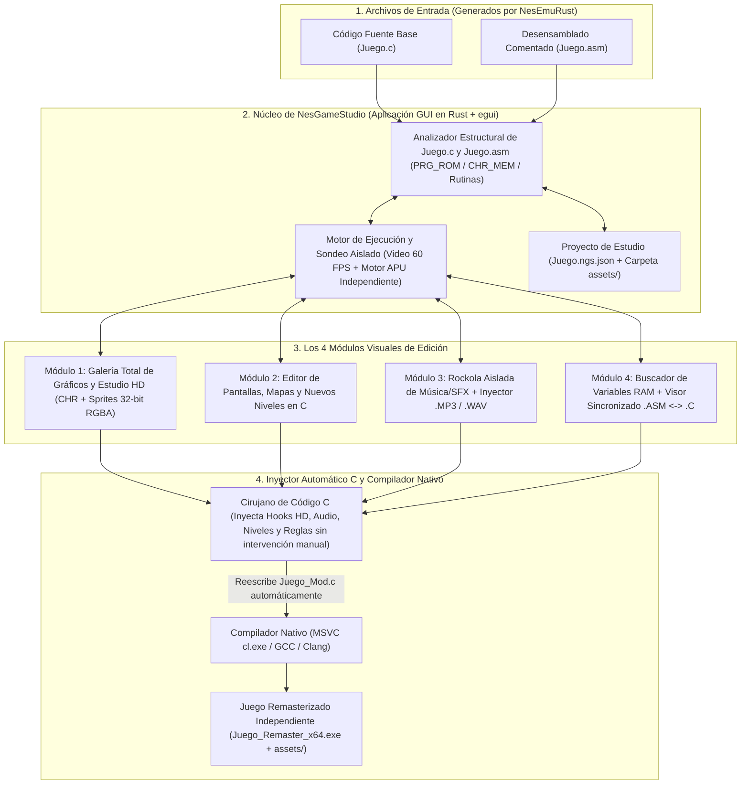
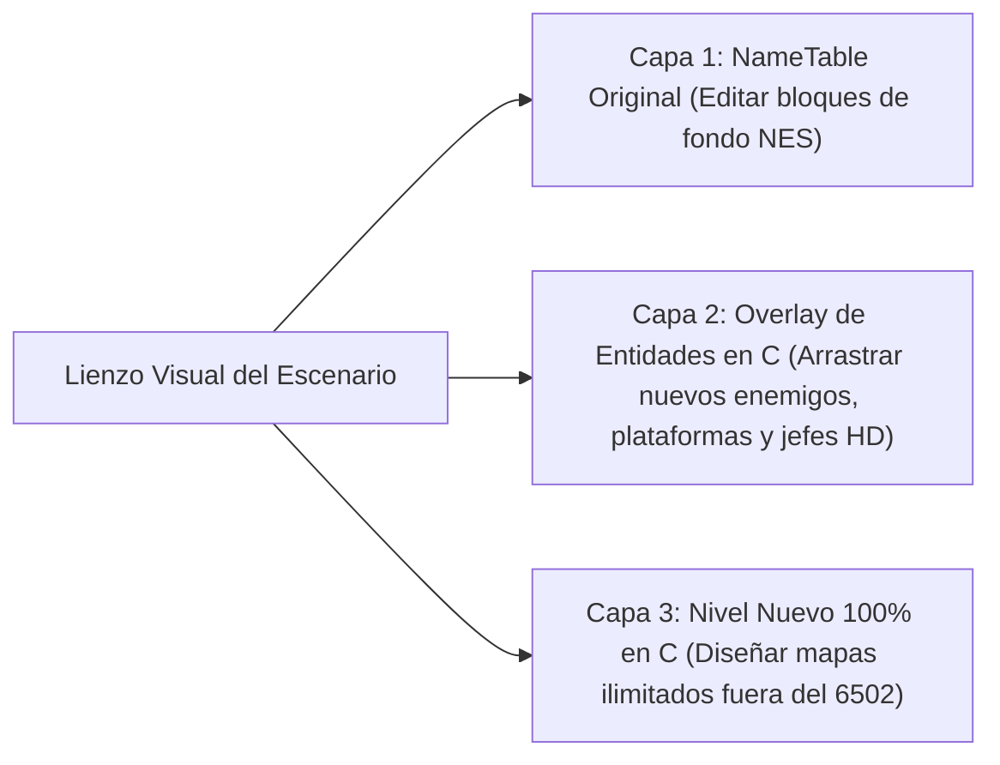
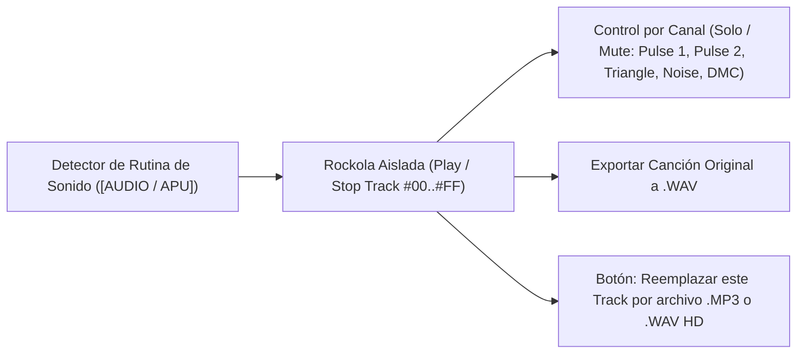

# `NesGameStudio` — Diseño Arquitectónico y Plan de Implementación

**`NesGameStudio`** es un entorno de desarrollo visual (IDE de Modding y Remasterización) independiente diseñado para cargar los archivos **`.c`** y **`.asm`** generados por [`NesEmuRust`](https://github.com/iztaneo/NesEmuRust), permitiendo transformar, expandir y modernizar cualquier juego clásico de NES en un juego nativo de PC (**x86/x64**) de alta calidad **de forma 100% visual, sin tener que entender ni editar manualmente código C ni ensamblador 6502**.

---

## 1. Filosofía: Edición 100% Visual e Inyección Automática en C

- **El usuario nunca necesita editar código a mano**: Todas las mejoras (gráficos HD, niveles, música `.MP3`/`.WAV` y reglas del juego) se realizan mediante herramientas visuales (pinceles, selectores de archivos, reproductor de música y lienzos de mapas), y **`NesGameStudio` modifica y recompila el archivo `.c` automáticamente por detrás**.
- **Exploración Total de Recursos**: Al abrir un juego (`.c` / `.asm`), `NesGameStudio` permite **visualizar todos los gráficos del juego** en una galería interactiva y **reproducir aisladamente cada canción y efecto de sonido** del juego en una rockola integrada (*Sound Test / Jukebox*).

---

## 2. Diagrama de Arquitectura de `NesGameStudio`



---

## 3. Diseño Detallado de los 4 Módulos Principales

### Módulo 1: Galería Completa de Gráficos y Estudio HD (`🎨 Todos los Gráficos y Sprites HD`)
Permite **visualizar y editar todos los gráficos contenidos en el juego** sin ver un solo número hexadecimal:

1. **Explorador Completo de Bancos Gráficos (*Full Game Graphic Browser*)**:
   - **Juegos con `CHR-ROM`** (*Super Mario Bros.*, *Mario 3*, *Castlevania*, etc.): Al abrir el archivo `.c`, `NesGameStudio` decodifica inmediatamente **todos los bancos de `CHR_MEM[]`** y muestra una galería completa con todos los personajes, enemigos de todos los niveles, jefes, objetos y bloques del juego sin necesidad de jugar hasta ese nivel.
   - **Juegos con `CHR-RAM`** (*Contra*, *Zelda*, *Mega Man*): Combina un escáner de patrones gráficos dentro de `PRG_ROM[]` con un **Catálogo de Capturas por Nivel**, permitiendo explorar y guardar en la galería todas las hojas de sprites descomprimidas de cada fase.
   - **Selector de Paletas y Armador de Metasprites**: Permite alternar entre todas las paletas de colores detectadas en el juego y ver los personajes completos (`16×32`, `32×32`) armados a partir de sus bloques de `8×8` u `8×16`.
2. **Edición Visual y Reemplazo por Gráficos HD (32-bit RGBA)**:
   - **Modo Pixel Art (8-bit)**: Pincel visual y botón **"Exportar / Importar `.BMP`"** para editar en Paint, GIMP o Aseprite.
   - **Modo Remaster HD (16×16 / 32×32 TrueColor)**: Seleccionas cualquier sprite o bloque en la galería y eliges una imagen `.PNG` / `.BMP` de **32 bits (16.7 millones de colores + transparencia alfa)**.
3. **Inyección Automática en el `.c`**:
   - `NesGameStudio` modifica automáticamente `ppu_render_scanline()` en el archivo `.c`, amplía el `FRAMEBUFFER` a `512×480` (`2x`) o `1024×960` (`4x`) e inserta el código C que dibuja tus nuevos gráficos HD.

---

### Módulo 2: Editor de Pantallas y Creador de Niveles (`🗺️ Pantallas y Niveles C`)
Permite editar los escenarios existentes o agregar niveles completamente nuevos con el mouse:



1. **Editor Visual de Pantallas (`NameTables` + Atributos)**:
   - Muestra el escenario como un lienzo interactivo donde tomas bloques de la Galería Gráfica y los pintas directamente sobre el mapa.
2. **Capa de Expansión en C (*Entity Overlay*)**:
   - Arrastras y sueltas **nuevos objetos, plataformas móviles, torretas o jefes HD** sobre cualquier nivel existente.
   - `NesGameStudio` escribe automáticamente las estructuras en C (`struct CustomEntity`), su física en punto flotante (`float`) y sus colisiones dentro del `.c`.
3. **Creador de Niveles Nuevos (*Custom Stages*)**:
   - Diseñador de niveles desde cero sin el límite de 2 KB de RAM ni de 4 colores de la NES. `NesGameStudio` genera automáticamente la función `run_custom_stage_c()` y la conecta al flujo del juego en el archivo `.c`.

---

### Módulo 3: Rockola Aislada de Música/Efectos e Inyector `.MP3` / `.WAV` (`🎵 Sound Test & Audio Studio`)
Permite **escuchar aisladamente cada canción y efecto de sonido del juego** y reemplazarlos con un clic:



1. **Reproductor Aislado de Música y Efectos (*Standalone Sound Test / Jukebox*)**:
   - `NesGameStudio` localiza las subrutinas clasificadas como `[AUDIO / APU]` en el `.asm`/`.c` y ejecuta el motor de sonido del juego **en un entorno aislado (sin correr el resto del juego)**.
   - Muestra una lista de pistas (`Track #00`, `Track #01`, `Track #02`...) con botones **▶️ Play**, **⏸️ Pausa** y **⏹️ Stop** para que puedas escuchar aisladamente cada canción de nivel, música de jefe o efecto de disparo/explosión.
   - Incluye botones **Solo / Mute por cada uno de los 5 canales** (`Pulse 1`, `Pulse 2`, `Triangle`, `Noise`, `DMC`), visualizador de ondas/notas en vivo y opción para **exportar cualquier canción o efecto original del juego a un archivo `.WAV`**.
2. **Reemplazo Visual por `.MP3` o `.WAV` de Alta Calidad**:
   - Al escuchar una pista en la rockola (por ejemplo, descubres que el `Track #01` es la música de la Jungla en *Contra* y el `Track #12` es el sonido del disparo), simplemente haces clic en **"🔁 Reemplazar esta pista por `.MP3` / `.WAV`"**.
   - Eliges tu archivo `.mp3` o `.wav` del disco y `NesGameStudio` inyecta automáticamente en el código `.c` el interceptor que silencia esa pista de 8 bits y reproduce tu archivo `.mp3` (vía `mciSendStringA`) o mezcla tu `.wav` polifónico a `44.1 kHz` cuando el juego solicite ese sonido.

---

### Módulo 4: Buscador de Variables RAM y Modificador Visual de Reglas (`🔍 Variables y Reglas`)
Permite cambiar vidas, armas, velocidades, gravedad o trucos mediante controles visuales:

1. **Escáner de Variables en Tiempo Real (*Variable Finder*)**:
   - Filtras valores (`3` vidas -> `2` vidas) en la vista previa y descubres al instante qué casilla de `RAM[]` controla cada elemento del juego.
2. **Panel de Reglas y Trucos sin Código**:
   - Le asignas un nombre (`VIDAS_JUGADOR`, `ARMA_ACTUAL`) y defines reglas con menús desplegables (*"Valor inicial = 30"*, *"Congelar siempre en Spread Gun"*, *"Al presionar tecla C dar invencibilidad"*).
   - `NesGameStudio` inyecta automáticamente ese código C en `nes_step_one_frame_60hz()`.
3. **Visor Sincronizado `.ASM` <-> `.C` (Radiografía Opcional)**:
   - Muestra lado a lado el ensamblador y el código C generado con casillas para activar/desactivar instrucciones específicas con un clic.

---

## 4. Estructura del Repositorio (`NesGameStudio`)

```text
NesGameStudio/
├── Cargo.toml                  # Aplicación GUI en Rust (eframe/egui, rfd, serde, image, cpal)
├── README.md                   # Descripción general y arquitectura en Mermaid
├── PLAN_IMPLEMENTACION.md      # Este documento de diseño e implementación
└── src/
    ├── main.rs                 # Ventana principal de NesGameStudio
    ├── project.rs              # Proyecto (.ngs.json), catálogo de pistas y carpeta assets/
    ├── parser/                 # Analizador y re-escritor automático de archivos .c y .asm
    ├── runtime/                # Motor de vista previa a 60 FPS y Rockola APU aislada
    ├── editors/
    │   ├── graphics.rs         # Módulo 1: Galería total de gráficos CHR y Sprites HD 32-bit
    │   ├── levels.rs           # Módulo 2: Editor de Pantallas NameTable y Niveles en C
    │   ├── audio.rs            # Módulo 3: Rockola aislada (Sound Test) e Inyector .MP3 / .WAV
    │   └── ram_inspector.rs    # Módulo 4: Buscador de Variables RAM, Reglas y Visor .ASM <-> .C
    └── codegen/                # Cirujano de código C y compilador automático a .exe nativo
```

---

## 5. Fases de Implementación Propuestas

1. **Fase 1 — Base del Estudio, Carga de `.c`/`.asm` y Compilación Automática**:
   - Interfaz principal con pestañas para los 4 módulos, analizador de arreglos `PRG_ROM[]`/`CHR_MEM[]` desde el `.c`, y botón de compilación directa a `.exe` nativo.
2. **Fase 2 — Galería Completa de Gráficos y Estudio HD (8-bit `.BMP` + 32-bit RGBA)**:
   - Visualizador de todos los bancos gráficos del juego, capturador de niveles `CHR-RAM`, editor de píxeles, importador de Sprites HD `.PNG`/`.BMP` e inyección automática del renderizador HD en el `.c`.
3. **Fase 3 — Rockola Aislada de Música/Efectos (*Sound Test*) e Inyector `.MP3` / `.WAV`**:
   - Reproductor aislado de pistas y efectos del juego con control Solo/Mute por canal, exportador a `.WAV` y reemplazo directo de pistas por archivos `.MP3`/`.WAV` inyectados en el `.c`.
4. **Fase 4 — Vista Previa en Vivo, Buscador de Variables RAM y Modificador de Reglas**:
   - Escáner interactivo de variables en `RAM`, etiquetador automático de `#define` y generador visual de reglas/trucos en C.
5. **Fase 5 — Editor Visual de Pantallas y Creador de Niveles en C**:
   - Lienzo de edición de escenarios, colocación de nuevas entidades C (*Overlay*) y creador de niveles 100% en C.
