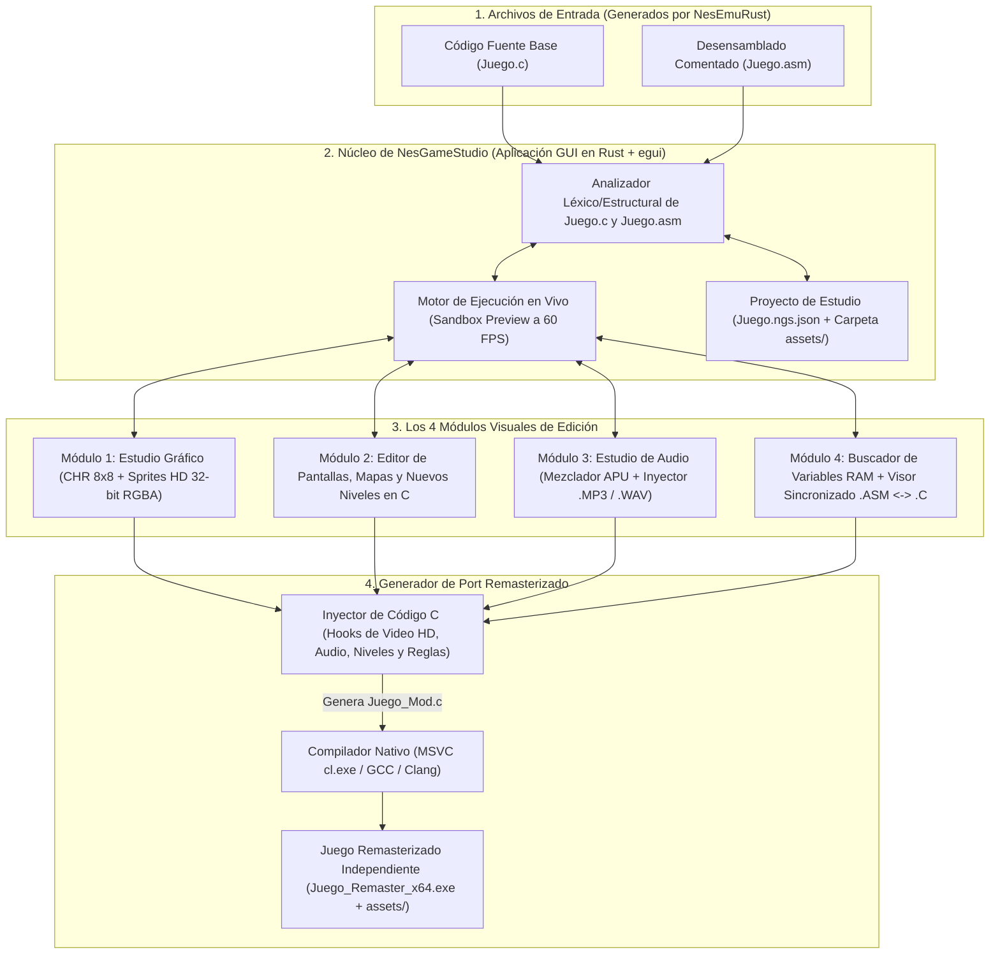
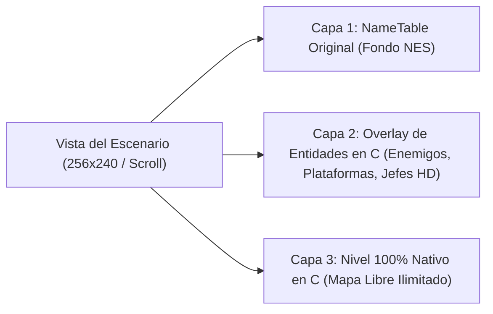

# `NesGameStudio` — Diseño Arquitectónico y Plan de Implementación

**`NesGameStudio`** es un entorno de desarrollo visual (IDE de Modding y Remasterización) independiente diseñado para cargar los archivos **`.c`** y **`.asm`** generados por [`NesEmuRust`](https://github.com/iztaneo/NesEmuRust), permitiendo transformar, expandir y modernizar cualquier juego clásico de NES en un juego nativo de PC (**x86/x64**) de alta calidad **sin tener que programar en ensamblador 6502 ni editar arreglos hexadecimales a mano**.

---

## 1. Filosofía y Problema que Resuelve

Cuando `NesEmuRust` recompila un cartucho `.nes` a un archivo `.c`:
- El juego ya compila y corre de forma nativa en Windows, pero **sus gráficos siguen codificados como bytes hexadecimales (`CHR_MEM[]` / `PRG_ROM[]`)**, **sus variables son direcciones anónimas (`RAM[0x0032]`)** y **su lógica está dentro de un enorme `switch(pc)`**.
- **`NesGameStudio`** actúa como un puente visual entre ese código `.c` crudo y el creador: interpreta el `.c` y el `.asm`, ejecuta un **motor de vista previa en vivo** para capturar pantallas/tiles dinámicos (incluso en juegos con compresión en RAM como *Contra*), y **re-escribe o inyecta código C limpio y recursos externos (`.bmp`, `.png`, `.wav`, `.mp3`)** automáticamente.

---

## 2. Diagrama de Arquitectura de `NesGameStudio`



---

## 3. Diseño Detallado de los 4 Módulos Principales

### Módulo 1: Estudio Gráfico (`🎨 Sprites, Tiles y HD Packs`)
Resuelve el problema de que en muchos juegos (como *Contra*, *Mega Man* o *Zelda*) los gráficos no están fijos al inicio, sino comprimidos dentro de `PRG_ROM` y se copian a `CHR_MEM` cuando inicia un nivel:

1. **Decodificador Visual de `CHR_MEM` y `OAM` en Vivo**:
   - Muestra una cuadrícula interactiva con los **512 tiles (`8×8`)** activos en la partida y la lista de los **64 sprites (`OAM`)** en pantalla.
   - Al pasar el mouse sobre cualquier enemigo o bloque en la vista previa del juego, el editor resalta qué `tile_id` y qué paleta está usando.
2. **Dos modos de edición gráfica**:
   - **Modo Clásico (Pixel Art 8×8 de 4 colores)**: Editor de píxeles integrado con pincel, relleno, espejo y selector de paleta NTSC, además de botón **"Exportar / Importar `.BMP`"** para editar en Paint o Aseprite.
   - **Modo Remaster HD (16×16 / 32×32 TrueColor 32-bit RGBA)**: Permite reemplazar cualquier tile de `8×8` (limitado a 3 colores) por una imagen `.PNG` / `.BMP` de **32 bits con millones de colores, sombras y transparencia alfa**.
3. **Cómo se inyecta en el `.c`**:
   - Si es edición clásica, actualiza o bloquea las celdas correspondientes de `CHR_MEM[]`.
   - Si es un **Pack HD**, `NesGameStudio` escala automáticamente el `FRAMEBUFFER` del archivo `.c` a `512×480` (`2x`) o `1024×960` (`4x`) e inyecta en `ppu_render_scanline()` el cargador de texturas HD de 32 bits.

---

### Módulo 2: Editor de Pantallas y Creador de Niveles (`🗺️ Pantallas y Niveles C`)
Permite tanto modificar los escenarios existentes como crear pantallas y niveles completamente nuevos sin las limitaciones del procesador 6502:



1. **Editor de Pantalla Activa (`NameTable` + Atributos de Color)**:
   - Muestra el escenario actual como un lienzo tipo *Tiled* / *Mario Maker*. Puedes seleccionar cualquier bloque de la paleta de tiles y pintarlo sobre el fondo.
2. **Capa de Expansión en C (*Entity Overlay*)**:
   - Permite arrastrar y soltar **nuevos objetos, plataformas móviles, torretas, trampas o jefes** sobre un nivel existente.
   - Estos objetos nuevos **no consumen memoria de la NES ni dependen del 6502**: `NesGameStudio` genera estructuras en C (`struct CustomEntity`) con física en punto flotante (`float x, y, vx, vy`), colisiones contra el jugador y renderizado directo sobre el `FRAMEBUFFER`.
3. **Creador de Niveles Nuevos 100% en C (*Custom Stages*)**:
   - Diseñador de mapas de ancho/alto libre donde defines bloques sólidos, plataformas, puntos de aparición de enemigos y música de fondo.
   - Al exportarlo, `NesGameStudio` inyecta la función `run_custom_stage_c()` dentro de `nes_step_one_frame_60hz()` y configura la condición de entrada (por ejemplo, al completar un nivel o presionar una tecla).

---

### Módulo 3: Estudio de Audio (`🎵 Mezclador APU + Inyector .MP3 / .WAV`)
Permite modernizar la banda sonora y los efectos de sonido sin descifrar el motor musical en ensamblador:

1. **Panel de Control de los 5 Canales APU**:
   - Interruptores visuales para mantener o silenciar individualmente `Pulse 1`, `Pulse 2`, `Triangle`, `Noise` y `DMC` en el código `.c` (por ejemplo, silenciar la melodía de `Pulse 1/2` y `Triangle` para poner música `.MP3`, pero dejar `Noise` y `DMC` activos para los efectos de disparo y explosiones).
2. **Asignador Visual de Pistas `.MP3` y Efectos `.WAV` (*Audio Triggers*)**:
   - Permite definir reglas visuales del tipo:
     - *"Cuando `STAGE_ID (RAM[0x0030]) == 0` -> Reproducir en bucle `assets/jungle_metal.mp3`"*.
     - *"Cuando el juego ejecute la subrutina `sub_D410` (Disparo) o cambie `RAM[0x00AA]` -> Mezclar `assets/laser_hd.wav` a 44.1 kHz"*.
3. **Generación de Código C de Audio (`winmm.lib`)**:
   - Inyecta automáticamente el gestor `mciSendStringA` para `.mp3` y el mezclador polifónico de buffers `.wav` a `44,100 Hz` dentro de `apu_submit_frame_audio()`.

---

### Módulo 4: Buscador de Variables RAM y Visor Sincronizado `.ASM` <-> `.C` (`🔍 Ingeniería Inversa Visual`)
Elimina la barrera de no saber qué hace cada dirección de memoria o cada subrutina:

1. **Escáner de Variables en Tiempo Real (*Cheat / Variable Finder*)**:
   - Mientras pruebas el juego en la vista previa integrada:
     - Filtras por valor exacto (ej. `3` vidas -> pierdes una -> `2` vidas) o por cambios (*"Subió"*, *"Bajó"*, *"No cambió"* al moverte a la derecha).
     - En segundos encuentras la dirección exacta (ej. `$0032` = Vidas, `$0334` = Posición X del Jugador).
2. **Diccionario de Símbolos del Juego**:
   - Le asignas un nombre legible (`PLAYER_LIVES`, `PLAYER_X`, `CURRENT_WEAPON`) y `NesGameStudio` reescribe automáticamente el código `.c` reemplazando `RAM[0x0032]` por `PLAYER_LIVES` en todo el archivo.
3. **Vista Dividida Sincronizada (`.ASM` a la izquierda <-> `.C` a la derecha)**:
   - Al hacer clic en cualquier variable o subrutina (`sub_XXXX`), muestra exactamente qué líneas del `.asm` y del `.c` la leen o modifican, permitiendo desactivar una instrucción (ej. hacer que nunca reste vidas) con una simple casilla de verificación (*checkbox*).

---

## 4. Estructura del Proyecto (`NesGameStudio`)

```text
NesGameStudio/
├── Cargo.toml                  # Aplicación GUI en Rust (eframe/egui, rfd, serde, image)
├── README.md                   # Descripción general y arquitectura en Mermaid
├── PLAN_IMPLEMENTACION.md      # Hoja de ruta detallada por fases
└── src/
    ├── main.rs                 # Ventana principal de NesGameStudio
    ├── project.rs              # Serialización del proyecto (.ngs.json) y carpeta assets/
    ├── parser/                 # Lector y re-escritor estructural de archivos .c y .asm
    ├── runtime/                # Motor de vista previa en vivo para captura de RAM/CHR/OAM
    ├── editors/
    │   ├── graphics.rs         # Módulo 1: Editor de Tiles 8x8 y Sprites HD 32-bit
    │   ├── levels.rs           # Módulo 2: Editor de Pantallas NameTable y Niveles en C
    │   ├── audio.rs            # Módulo 3: Mezclador APU e Inyector .MP3 / .WAV
    │   └── ram_inspector.rs    # Módulo 4: Buscador de Variables RAM y Visor .ASM <-> .C
    └── codegen/                # Inyector de C y compilador automático a .exe nativo
```

---

## 5. Fases de Implementación Propuestas

1. **Fase 1 — Base del Estudio y Lector de Proyectos (`.c` + `.asm`)**:
   - Interfaz principal con pestañas para los 4 módulos, carga de archivos `.c`/`.asm` exportados por `NesEmuRust`, visor sincronizado `.ASM` <-> `.C` y compilación en un clic a `.exe`.
2. **Fase 2 — Motor de Vista Previa en Vivo y Buscador de Variables RAM**:
   - Ejecución del juego dentro del estudio para inspeccionar `RAM`, `CHR_MEM` y `OAM` en tiempo real, escáner de variables y renombrado automático a `#define` legibles en el `.c`.
3. **Fase 3 — Estudio Gráfico (8-bit `.BMP` y Packs HD de 32 bits)**:
   - Editor visual de tiles y sprites, exportación/importación `.bmp`/`.png` e inyección automática del renderizador HD (`512×480` / `1024×960` RGBA) en el archivo `.c`.
4. **Fase 4 — Estudio de Audio (`.MP3` y `.WAV` Polifónico)**:
   - Silenciador selectivo de canales APU, disparadores de audio por eventos de RAM/PC e inyección del mezclador `.mp3`/`.wav` en el `.c`.
5. **Fase 5 — Editor de Pantallas y Creador de Niveles/Entidades en C**:
   - Lienzo visual para editar escenarios originales, colocar nuevas entidades en C (*Overlay*) y diseñar niveles completos 100% en C.
