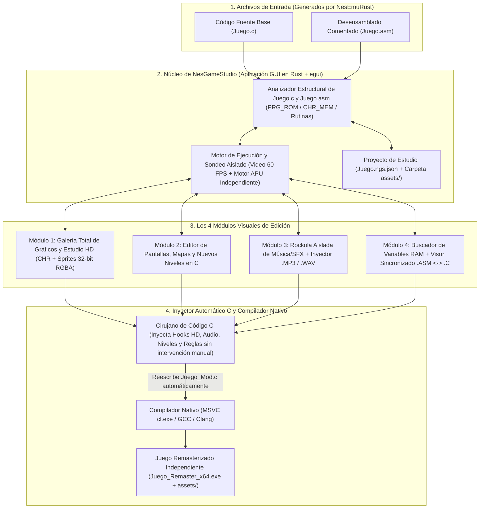
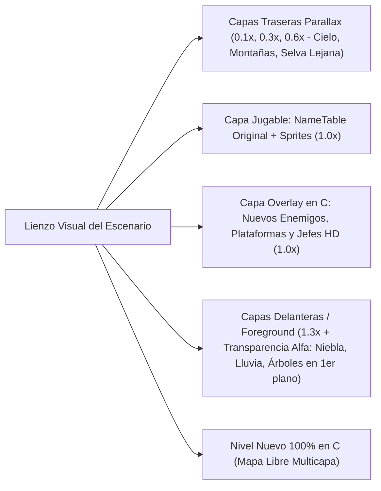
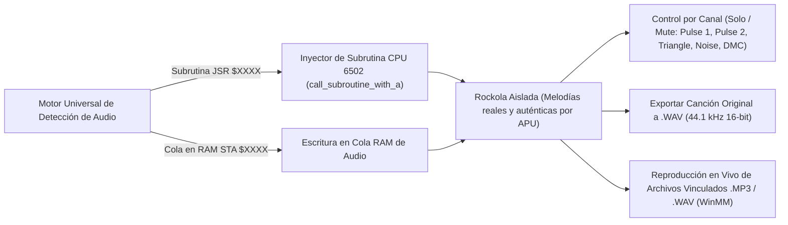
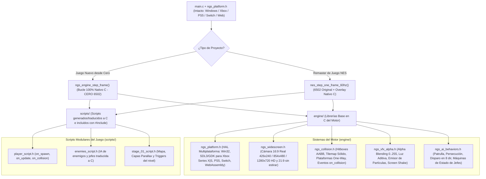
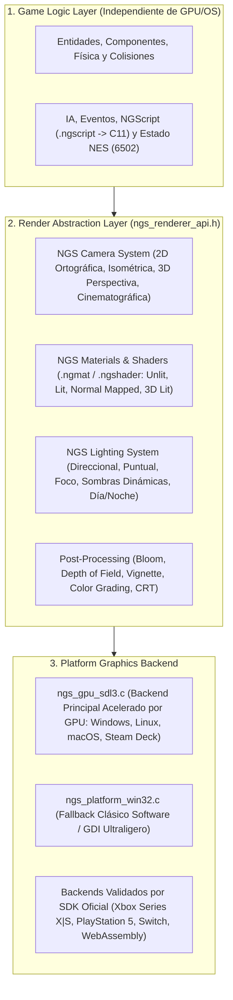

# `NesGameStudio` — Diseño Arquitectónico y Plan de Implementación

**`NesGameStudio`** es un entorno de desarrollo visual (IDE de Modding y Remasterización) independiente diseñado para cargar los archivos **`.c`** y **`.asm`** generados por [`NesEmuRust`](https://github.com/iztaneo/NesEmuRust), permitiendo transformar, expandir y modernizar cualquier juego clásico de NES en un juego nativo de PC (**x86/x64**) de alta calidad **de forma 100% visual, sin tener que entender ni editar manualmente código C ni ensamblador 6502**.

---

## 1. Filosofía y Arquitectura de Lenguaje Base (Híbrida: Rust + C)

### 1.1. Decisión de Lenguaje Base: **Arquitectura Híbrida (Editor en Rust + Juegos Generados en C)**
Para obtener la máxima productividad en la interfaz gráfica y la máxima velocidad de compilación en los juegos finales, **`NesGameStudio`** utiliza un modelo híbrido de dos capas:

| Capa del Sistema | Lenguaje y Tecnologías Base | Justificación Técnica |
| :--- | :--- | :--- |
| **1. El Editor / IDE Visual (`NesGameStudio`)** | **Rust (`Edition 2021`)** + `eframe`/`egui` (GUI), `cpal` (Audio en vivo), `image` (Carga `.PNG`/`.BMP`), `serde_json` (Proyectos `.ngs.json`) | Permite reutilizar directamente los núcleos de CPU, PPU y APU de `NesEmuRust` para la Vista Previa y la Rockola Aislada, manipular archivos de código `.c`/`.asm` de decenas de miles de líneas con seguridad de memoria absoluta y construir paneles visuales complejos rápidamente. |
| **2. El Motor de los Juegos Exportados (`Runtime Target`)** | **C Estándar Puro (`C99/C11`)** + `Win32 API` (`user32.lib`, `gdi32.lib`, `winmm.lib`) compilado vía `cl.exe /O2`, `gcc` o `clang` | El código que `NesGameStudio` inyecta o genera desde cero es **100% C puro sin dependencias externas**. Compila en ~1 segundo a un ejecutable `.exe` nativo ultraligero (`< 2 MB`) que corre en cualquier PC Windows sin instalar runtimes. |

### 1.2. Edición 100% Visual e Inyección Automática en C
- **El usuario nunca necesita editar código a mano**: Todas las mejoras (gráficos HD, capas Parallax, niveles, música `.MP3`/`.WAV` y reglas del juego) se realizan mediante herramientas visuales (pinceles, selectores de archivos, reproductor de música y lienzos de mapas), y **`NesGameStudio` modifica y recompila el archivo `.c` automáticamente por detrás**.
- **Exploración Total de Recursos**: Al abrir un juego (`.c` / `.asm`), `NesGameStudio` permite **visualizar todos los gráficos del juego** en una galería interactiva y **reproducir aisladamente cada canción y efecto de sonido** del juego en una rockola integrada (*Sound Test / Jukebox*).

---

## 2. Diagrama de Arquitectura de `NesGameStudio`



---

## 3. Diseño Detallado de los 4 Módulos Principales

### Módulo 1: Galería Completa de Gráficos y Estudio HD (`🎨 Todos los Gráficos y Sprites HD`)
Permite **visualizar y editar todos los gráficos contenidos en el juego** sin ver un solo número hexadecimal:

1. **Explorador Completo de Bancos Gráficos (*Full Game Graphic Browser*)**:
   - **Juegos con `CHR-ROM`** (*Super Mario Bros.*, *Mario 3*, *Castlevania*, etc.): Al abrir el archivo `.c`, `NesGameStudio` decodifica inmediatamente **todos los bancos de `CHR_MEM[]`** y muestra una galería completa con todos los personajes, enemigos de todos los niveles, jefes, objetos y bloques del juego sin necesidad de jugar hasta ese nivel.
   - **Juegos con `CHR-RAM`** (*Contra*, *Zelda*, *Mega Man*): Combina un escáner de patrones gráficos dentro de `PRG_ROM[]` con un **Catálogo de Capturas por Nivel**, permitiendo explorar y guardar en la galería todas las hojas de sprites descomprimidas de cada fase.
   - **Selector de Paletas y Armador de Metasprites**: Permite alternar entre todas las paletas de colores detectadas en el juego y ver los personajes completos (`16×32`, `32×32`) armados a partir de sus bloques de `8×8` u `8×16`.
2. **Edición Visual y Reemplazo por Gráficos HD (32-bit RGBA)**:
   - **Modo Pixel Art (8-bit)**: Pincel visual y botón **"Exportar / Importar `.BMP`"** para editar en Paint, GIMP o Aseprite.
   - **Modo Remaster HD (16×16 / 32×32 TrueColor)**: Seleccionas cualquier sprite o bloque en la galería y eliges una imagen `.PNG` / `.BMP` de **32 bits (16.7 millones de colores + transparencia alfa)**.
3. **Inyección Automática en el `.c` y Soporte Widescreen 16:9 / 21:9 Real**:
   - `NesGameStudio` modifica automáticamente `ppu_render_scanline()` en el archivo `.c`, amplía el `FRAMEBUFFER` y permite elegir entre relación **4:3 Clásica (`256×240` / `512×480` / `1024×960`)** o **Widescreen 16:9 Real sin estirar (`426×240` / `854×480` / `1280×720`)** y **21:9 Ultrawide**.
   - En modo **Widescreen 16:9 Real**, el motor renderiza `85 píxeles` adicionales reales a cada lado desde las *NameTables* adyacentes y extiende las capas *Parallax*, manteniendo las barras de estado (HUD) centradas y permitiendo que los sprites y enemigos se dibujen en los márgenes laterales sin desaparecer a los 256 píxeles.

---

### Módulo 2: Editor de Pantallas y Creador de Niveles (`🗺️ Pantallas y Niveles C`)
Permite editar los escenarios existentes o agregar niveles completamente nuevos con el mouse:



1. **Sistema de Profundidad Multicapa (*Unlimited Parallax & Foreground Layers*)**:
   - La NES original solo soportaba **1 capa de fondo** sin transparencia real. En `NesGameStudio` puedes agregar **múltiples capas de profundidad superpuestas** (tanto detrás del escenario como delante del jugador):
     - **Capas de Fondo (*Back Parallax*, velocidad `0.0x` a `0.9x`)**: Se dibujan automáticamente detrás de los píxeles transparentes (`pixel == 0`) del escenario original, desplazándose de forma suave según la cámara acumulada del juego (`camera_world_x * factor_parallax`).
     - **Capas de Primer Plano (*Foreground + Alpha Blending*, velocidad `1.1x` a `2.0x`)**: Se dibujan **por encima de los sprites y del escenario** usando canal Alfa de 32 bits (`RGBA`), permitiendo efectos modernos como neblina translúcida, lluvia, haces de luz (*god rays*), columnas o follaje que pasa frente a la cámara.
2. **Editor Visual de Pantallas (`NameTables` + Atributos)**:
   - Muestra el escenario como un lienzo interactivo donde tomas bloques de la Galería Gráfica y los pintas directamente sobre el mapa.
3. **Capa de Expansión en C (*Entity Overlay*)**:
   - Arrastras y sueltas **nuevos objetos, plataformas móviles, torretas o jefes HD** sobre cualquier nivel existente.
   - `NesGameStudio` escribe automáticamente las estructuras en C (`struct CustomEntity`), su física en punto flotante (`float`) y sus colisiones dentro del `.c`.
4. **Creador de Niveles Nuevos (*Custom Stages*) y Selector de Modo de Scrolling (`engine/ngs_scroll_camera.h`)**:
   - Diseñador de niveles desde cero sin el límite de 2 KB de RAM ni de 4 colores de la NES, donde eliges el tipo de desplazamiento de cámara con un clic:
     - **Scroll Horizontal (`SCROLL_HORIZONTAL`)**: Clásico de plataformas y *Run & Gun* (con opción de avance libre o bloqueo de retroceso estilo *Contra* / *Super Mario Bros.*).
     - **Scroll Vertical (`SCROLL_VERTICAL`)**: Ascendente o descendente (para etapas verticales tipo *Ice Climber*, Fase 3 de *Contra* o *Shoot 'em ups* verticales como *1942*), con capas *Parallax* verticales (`camera_world_y * factor_parallax`).
     - **Auto-Scroll Programable (`SCROLL_AUTO_PATH`)**: La cámara avanza sola siguiendo una ruta o velocidad variable para niveles de naves o persecuciones.
     - **Scroll Libre en 8 Direcciones (`SCROLL_FREE_8WAY` — RPG Top-Down y Metroidvania)**: El mapa puede medir cientos de pantallas a lo ancho y alto; la cámara sigue al jugador suavemente (*Camera Lerp + Deadzone*) y se detiene automáticamente en los bordes de cada habitación o ciudad (*Camera Bounds*), con soporte para puertas de teletransporte (*Warp Tiles*) hacia interiores de casas, tiendas o calabozos.

---

### Módulo 3: Rockola Aislada de Música/Efectos e Inyector `.MP3` / `.WAV` (`🎵 Sound Test & Audio Studio`)
Permite **escuchar aisladamente cada canción y efecto de sonido del juego** y reemplazarlos con un clic:



1. **Reproductor Aislado de Música y Efectos (*Standalone Sound Test / Jukebox*)**:
   - **Motor Universal de Detección**: Implementa un análisis dinámico del PRG-ROM que identifica tanto llamadas a subrutina de sonido (`JSR $XXXX` con `A = sound_id`, como `$C16B` en *Contra*, `$E25F` en *Castlevania III*, `$CE31` en *Chip 'n Dale 2*, `$F81F` en *Tiny Toons*) como escrituras en colas de RAM de audio (`STA $XXXX`, como `$04F5` en *Super Mario Bros. 3*, `$0700` en *Ninja Gaiden II*, `$0042` en *Batman*, `$0602` en *Zelda*).
   - **Pistas Reales y Únicas**: Cada tema musical y efecto de sonido de la lista invoca su comando real en el motor sonoro 6502, asegurando que cada pista produzca melodías y frecuencias de audio APU completamente distintas y auténticas.
   - **Control de Canales y Grabación**: Botones **Solo / Mute por cada uno de los 5 canales** (`Pulse 1`, `Pulse 2`, `Triangle`, `Noise`, `DMC`), osciloscopio en tiempo real, panel de control de partida en vivo para avanzar pantallas, memorizador de pistas (`📌 Memorizar`) y grabador a archivo `.WAV`.
2. **Reemplazo Visual por `.MP3` o `.WAV` de Alta Calidad**:
   - Al escuchar una pista en la rockola, haz clic en **"📂 Vincular archivo .MP3 / .WAV"** para asociar una versión orquestada o moderna.
   - La Rockola reproduce de inmediato el archivo de alta fidelidad vía `winmm::mciSendStringA`, mostrando la animación sincronizada en el osciloscopio.

---

### Módulo 4: Buscador de Variables RAM y Modificador Visual de Reglas (`🔍 Variables y Reglas`)
Permite cambiar vidas, armas, velocidades, gravedad o trucos mediante controles visuales:

1. **Escáner de Variables en Tiempo Real (*Variable Finder*)**:
   - Filtras valores (`3` vidas -> `2` vidas) en la vista previa y descubres al instante qué casilla de `RAM[]` controla cada elemento del juego.
2. **Panel de Reglas y Trucos sin Código**:
   - Le asignas un nombre (`VIDAS_JUGADOR`, `ARMA_ACTUAL`) y defines reglas con menús desplegables (*"Valor inicial = 30"*, *"Congelar siempre en Spread Gun"*, *"Al presionar tecla C dar invencibilidad"*).
   - `NesGameStudio` inyecta automáticamente ese código C en `nes_step_one_frame_60hz()`.
3. **Visor Sincronizado `.ASM` <-> `.C` (Radiografía Opcional)**:
   - Muestra lado a lado el ensamblador y el código C generado con casillas para activar/desactivar instrucciones específicas con un clic.

### Módulo 5: Creador de Juegos Nuevos desde Cero (`🚀 Motor Nativo Sin 6502, Colisiones, VFX, IA y Multiplataforma`)
Convierte a `NesGameStudio` en un **"Mini-Unity" especializado en juegos 2D / 2.5D Retro y HD**.

> [!IMPORTANT]
> **¿Usa el procesador 6502 un juego nuevo creado desde cero?**  
> **NO.** Cuando creas un juego nuevo en `NesGameStudio`, **se elimina por completo la CPU 6502 (`switch(pc)`, registros `A, X, Y` y RAM de 2 KB)**. El juego corre sobre un **Bucle Propio 100% Nativo de `NesGameStudio` en C moderno (`ngs_engine_step_frame`)**, usando variables `float`, estructuras limpias (`NgsEntity`, `NgsWorld`) y memoria libre de 64 bits. *(El núcleo 6502 solo se incluye cuando abres un juego comercial antiguo de NES para modificarlo).*



0. **Bucle Propio de `NesGameStudio` para Juegos Nuevos (`ngs_engine_step_frame`)**:
   - En lugar de simular ciclos de un procesador de 1983, ejecuta 7 pasos limpios en C cada `16.6 ms` (`60 FPS`):
     1. `ngs_input_poll()` — Lee mandos modernos (Teclado, Xbox, DualSense PS5).
     2. `ngs_camera_update()` — Calcula el encuadre Widescreen `16:9` / `21:9` y los desplazamientos de las capas *Parallax*.
     3. `ngs_scripts_update()` — Ejecuta los scripts `on_update()` del jugador, enemigos y jefes.
     4. `ngs_physics_and_collisions()` — Aplica velocidades en `float`, gravedad, colisión con el mapa (`SOLID`, `ONE_WAY`) y cajas `AABB`, disparando `on_collision()`.
     5. `ngs_vfx_update()` — Actualiza partículas, luces aditivas, transparencias alfa (`0..255`) y temblor de cámara.
     6. `ngs_render_scene_hd()` — Compone todas las capas *Parallax*, sprites HD y *Foreground* en el `FRAMEBUFFER`.
     7. `ngs_audio_mix()` — Mezcla pistas `.MP3`/`.WAV` y efectos *chiptune* opcionales.

1. **Lenguaje Propio de Comportamiento (`NGScript` / `.ngscript`) Transpilado Automáticamente a C (Sin tocar `main.c`)**:
   - Para que no tengas que lidiar con punteros de C (`*`), cabeceras ni errores de sintaxis, **crearemos nuestro propio lenguaje declarativo de comportamiento (`NGScript`)** que puede editarse como texto ultra-simple o mediante bloques visuales en el estudio.
   - **¿Cómo funciona por dentro?** `NesGameStudio` incluye un **Transpilador (`NGScript -> C99`)**: tú escribes en `.ngscript`, y al guardar, el estudio traduce tu lógica a un archivo `.h` en C optimizado (`scripts/jefe_alien.h`) y actualiza automáticamente la tabla maestra `scripts/ngs_scripts_registry.h`. **El bucle del juego en `main.c` jamás se toca a mano**.
   - **Ejemplo de lo que escribes en `NGScript` (`jefe_alien.ngscript`)**:
     ```text
     entidad JefeAlien (vida = 100, capa = ENEMIGO) {
         estado PATRULLA {
             mover_x(velocidad = 1.5, rebotar_en_pared = true)
             cada 90 frames:
                 disparar("BalaPlasma", hacia = JUGADOR, velocidad = 4.0)
             si vida < 50:
                 iniciar_escena("cutscene_jefe_furia")
                 cambiar_estado(FURIA)
         }

         estado FURIA {
             transparencia(160)
             luz_dinamica(radio = 80, color = ROJO)
             perseguir(JUGADOR, velocidad = 2.8)
         }

         al_colisionar_con(BALA_JUGADOR, proyectil):
             restar_vida(proyectil.dano)
             efecto_particulas("chispas", x, y)
             destruir(proyectil)
             si vida <= 0:
                 efecto_explosion_hd(x, y)
                 desbloquear_logro("CAZADOR_DE_ALIENS")
                 destruir(este)
     }
     ```
   - **Lo que `NesGameStudio` genera e incluye solo en `scripts/jefe_alien.h`**:
     - Genera las funciones `jefe_alien_on_update(NgsEntity* self)` y `jefe_alien_on_collision(NgsEntity* self, NgsEntity* other)` y las registra automáticamente en el arreglo de punteros a función `g_entity_vtable[]` dentro de `scripts/ngs_scripts_registry.h`.

2. **Sistema de Detección de Colisiones Automático (`engine/ngs_collision.h`) — Sin tocar el Bucle Principal**:
   - El bucle principal (`ngs_engine_step_frame()`) llama siempre a `ngs_physics_and_collisions()`, el cual resuelve **3 niveles de colisión de forma automática en cada frame (60 FPS)**:
     1. **Colisión Entidad vs. Mapa (*Tilemap Grid Collider — O(1)*)**:
        - En el editor pintas sobre el escenario una máscara invisible con el tipo de cada bloque: `SOLID` (pared/piso), `ONE_WAY` (plataforma atravesable desde abajo estilo *Contra*), `SLOPE_45` (rampa/escalera diagonal), `LADDER` (escalera), `WATER` (agua) o `WARP_DOOR` (puerta a otro mapa/tienda RPG).
        - El motor detiene la caída por gravedad al pisar `SOLID`/`ONE_WAY`, empuja al personaje fuera de las paredes y activa el flag `self->on_ground = 1`.
     2. **Colisión Entidad vs. Entidad (*AABB Hitbox / Hurtbox + Capas de Máscara*)**:
        - En el editor dibujas dos rectángulos sobre cada sprite:
          - 🟩 **`Hurtbox` (Caja Vulnerable)**: dónde puede recibir daño o recoger ítems.
          - 🟥 **`Hitbox` (Caja de Ataque)**: el filo de una espada, un proyectil o el cuerpo de un enemigo.
        - Cada entidad pertenece a una **Capa (`LAYER_PLAYER`, `LAYER_ENEMY`, `LAYER_PLAYER_BULLET`, `LAYER_ENEMY_BULLET`, `LAYER_ITEM`, `LAYER_NPC`)**. El motor compara únicamente las capas que deben chocar entre sí y, cuando dos rectángulos se intersectan:
          ```c
          if (ngs_aabb_overlap(a->hitbox_world, b->hurtbox_world)) {
              // Despacha automáticamente al script traducido de A y de B sin tocar main.c:
              g_entity_vtable[a->script_id].on_collision(a, b);
              g_entity_vtable[b->script_id].on_collision(b, a);
          }
          ```
     3. **Zonas de Trigger / Sensores Invisibles (*Scene & RPG Triggers*)**:
        - Rectángulos invisibles que colocas en el mapa (ej. *"Zona de entrada al Jefe"* o *"Mostrador del Vendedor RPG"*). Al entrar el jugador en ese rectángulo, el motor dispara automáticamente el diálogo (`ngs_start_dialogue("mercader_01")`) o la escena cinemática (`ngs_play_cutscene("intro_jefe")`).

3. **Efectos Visuales, Transparencias, Iluminación Dinámica 2D y Efectos Programables en `NGScript` (`engine/ngs_vfx_alpha.h` + `ngs_lighting.h` + `scripts/vfx_*.h`)**:
   - **Transparencia Real (`Alpha Blending 0..255`)**: Cualquier sprite, capa Parallax o neblina tiene una propiedad `alpha` (`0` = invisible, `128` = 50% translúcido, `255` = opaco) mezclada por canal `RGBA` de 32 bits.
   - **Iluminación Dinámica 2D y Sombras en Tiempo Real (`ngs_lighting.h`)**: Permite colocar fuentes de luz dinámicas (antorchas, explosiones, faroles, ciclos de día/noche o proyectiles láser que iluminan el piso y las paredes conforme viajan en la oscuridad) con atenuación radial suave sobre el `FRAMEBUFFER` de 32 bits.
   - **Efectos Prehechos + Creación de Efectos Propios desde `NGScript` (`efecto_particulas` y `shader_2d`)**:
     - Además de los efectos listos para usar (`vfx_explosion`, `vfx_sparks`, `vfx_rain`, `vfx_screen_shake`), **puedes programar tus propios efectos visuales, magias RPG, estelas (*Afterimages*) y distorsiones de pantalla usando `NGScript`**, y el estudio los transpila a C nativo (`scripts/vfx_custom.h`):
     ```text
     // 1. Definir un emisor de partículas propio (ej. Hechizo de Fuego o Sangre/Chispas)
     efecto_particulas "FuegoMagico" {
         cantidad = 45
         velocidad = (1.5 .. 4.0), angulo = (0 .. 360)
         gravedad = -0.08               // Flota hacia arriba como brasas
         color = #FFCC00 -> #FF2200     // Transición de amarillo a rojo
         alfa = 255 -> 0, vida_frames = 40
         mezcla = ADITIVO               // Brillo intenso al superponerse
         luz_por_particula(radio = 18, color = #FF6600)
     }

     // 2. Definir un Shader 2D / Efecto de Post-Procesado por Scanline o Píxel
     shader_2d "OndasBajoElAgua" {
         para_cada_scanline(y):
             desplazar_x(y, sin(y * 0.12 + tiempo * 0.08) * 3.5)
             tinte_color(#80B0FF, fuerza = 0.25)
     }
     ```
     - También incluye la directiva `estela_fantasma(intervalo = 3, alfa_inicial = 180, tinte = #00FFFF)` en `NGScript` para crear el clásico efecto de sombras translúcidas al hacer *dash* o ataques especiales (estilo *Castlevania: Symphony of the Night* o *Mega Man X*).

4. **Inteligencia Artificial (IA) de Personajes y Jefes (`engine/ngs_ai_behaviors.h`)**:
   - **Comportamientos Preconstruidos Seleccionables**: Desde el editor puedes asignarle a cualquier enemigo una IA lista para usar sin escribir código:
     - `AI_PATROL_SMART`: Camina por una plataforma y da vuelta al detectar un borde o pared.
     - `AI_TURRET_SNIPER`: Calcula el ángulo hacia `(player.x, player.y)` y dispara proyectiles dirigidos cada `N` frames.
     - `AI_CHASER / JUMPER`: Persigue al jugador y salta obstáculos.
     - `AI_FLYING_WAVE`: Movimiento aéreo senoidal o en picada.
   - **Máquinas de Estado para Jefes (*Boss Scripting*)**: Permite encadenar fases visuales o por script (*"Fase 1: Dispara abanico -> Si `hp < 50%` -> Fase 2: Se vuelve semitransparente, tiembla la pantalla y embiste"*).

5. **Poderes de Tiempo: Rebobinado en Vivo (*Time Rewind*) y Cámara Lenta (*Bullet Time*) (`engine/ngs_time_control.h`)**:
   - **Buffer Circular de Estados (`600 frames` / 10 segundos)**: Como el estado completo del juego en C ocupa apenas unos kilobytes por frame, el motor guarda un historial continuo en memoria RAM.
   - **Time Rewind & Bullet Time**: Con activar una casilla en `NesGameStudio`, el jugador puede mantener presionado un gatillo o tecla para **rebobinar el tiempo en vivo** (con filtro visual tipo VHS) si cometió un error, o activar **Cámara Lenta (*Bullet Time* a `0.25x` / `0.5x`)** para esquivar lluvias de proyectiles.

6. **Editor de Animaciones (*Sprite Timeline*), Director de Escenas *In-Engine* (`engine/ngs_cutscenes.h`) y Sistema de Diálogos RPG (`engine/ngs_rpg_dialogue.h`)**:
   - **Línea de Tiempo de Animación (*Sprite Timeline*)**: Editor visual para armar secuencias de cuadros (*Idle, Correr, Saltar, Disparar, Hablar, Morir*), ajustar la duración en milisegundos de cada cuadro, editar su *Hitbox* por frame y vincular en qué cuadro exacto se dispara un sonido o proyectil.
   - **Editor Visual de Diálogos Ramificados y Modo RPG (`engine/ngs_rpg_dialogue.h` + `scripts/rpg_dialogues.h`)**:
     - Permite diseñar conversaciones mediante **nodos conectados visualmente (*Dialogue Tree*)**: cada caja de texto incluye retrato animado del personaje (con cambios de expresión facial), efecto máquina de escribir con sonido por letra y **respuestas de opción múltiple (`Sí / No / Comprar / Aceptar misión`)**.
     - Soporta **Banderas de Historia y Condiciones (`Quest Flags`)** (ej. si `tiene_llave_antigua == 1`, el NPC te abre el templo; si no, te da una pista), además de tablas listas para **RPG**: estadísticas (`HP`, `MP`, `EXP`, `Nivel`, `Oro`), inventario de objetos, cofres y tiendas, más localización multi-idioma (`ES` / `EN`).
   - **Director de Escenas Generadas 100% con el Motor del Juego (*In-Engine Cutscene Sequencer*)**:
     - En lugar de insertar videos `.mp4` pregrabados que pesan cientos de megabytes y rompen la estética, las escenas cinemáticas **se ejecutan en tiempo real usando el propio motor del juego, el mismo mapa y los mismos sprites**:
       1. **Pista de Cámara**: Mueve la cámara suavemente de un punto a otro del escenario (`Camera Pan / Lerp`), aplica *Zoom*, activa barras negras de cine arriba y abajo (*Letterbox*) o sacude la pantalla (*Screen Shake*).
       2. **Pista de Actores (*Sprites*)**: Ordena en la línea de tiempo que el protagonista, los aliados o el jefe caminen de `(x1, y1)` a `(x2, y2)`, cambien de animación (ej. desenvainar espada, caer de rodillas), o muestren globos de emoción (`!`, `?`, `...`) sobre su cabeza.
       3. **Pista de Diálogos, Luz y Audio**: Dispara cajas de diálogo sincronizadas con los movimientos de los personajes, oscurece el ambiente o enciende luces dinámicas (`ngs_lighting.h`), lanza partículas (lluvia, relámpagos, explosiones) y cambia la música de fondo con *Fade-Out / Fade-In*.
     - Todo lo que armas en el editor visual se traduce automáticamente a un script declarativo en C (`scripts/cutscene_intro.h`, `scripts/cutscene_jefe.h`) incluido con `#include` sin tocar `main.c`.

7. **Generador de Efectos Retro (*Sfxr*) y *Piano Roll* Musical Integrado (en el Módulo 3)**:
   - **Generador de Sonidos en 1 Clic (*Sfxr Integrado*)**: Botones instantáneos (*"🔊 Generar Disparo"*, *"💥 Generar Explosión"*, *"🪙 Generar Moneda/Ítem"*, *"🦘 Generar Salto"*, *"⚡ Generar Láser"*) con deslizadores de tono, caída y vibrato que sintetizan nuevos efectos `.WAV` o secuencias APU dentro del estudio.
   - **Teclado y *Piano Roll* Chiptune**: Editor musical por notas para componer melodías nuevas desde cero sin programas externos.

8. **Multijugador de 2 a 4 Jugadores: Cooperativo Local y *Netplay* Online P2P (`engine/ngs_netplay.h`)**:
   - **Hasta 4 Mandos simultáneos**: Soporte para 2 a 4 jugadores en pantalla tanto en juegos nuevos como inyectando un compañero cooperativo en juegos clásicos.
   - **Netplay P2P Ligero (`winsock2.lib` UDP)**: Sincronización determinista de entradas (*Input Lockstep / Rollback ligero*) que permite jugar cooperativo en línea entre dos PCs enviando únicamente los bytes de botones de cada frame.

9. **Sistema de Logros (*Achievements*), Menú de Pausa *Overlay* Moderno y *Speedrun Timer* (`engine/ngs_overlay_ui.h`)**:
   - **Menú *Overlay* In-Game**: Inyecta en el ejecutable `.exe` un menú moderno al presionar `Esc` / `Start` con guardado/carga instantánea en múltiples ranuras, reconfiguración de controles y ajuste de volumen.
   - **Logros Desbloqueables y Cronómetro de Speedrun**: Permite definir logros visuales en el estudio (ej. *"Pasar el Nivel 1 sin perder vidas"* o *"Derrotar al Jefe en menos de 40s"*) que muestran una notificación animada en pantalla al cumplirse y guardan las medallas y récords de tiempo en disco.

10. **Plantillas de Género y Biblioteca Global de "Mashup"**:
    - Incluye plantillas base (*Run & Gun*, *Plataformas*, *Top-Down Aventura*, *Shoot 'em Up*) y permite combinar recursos extraídos de cualquier juego NES con gráficos HD y sonidos propios.

11. **Exportación Multiplataforma a PC, Consolas (`PS5`, `Xbox Series X|S`, `Switch`) y Web (`engine/ngs_platform.h`)**:
   - Como el 100% del motor gráfico (`FRAMEBUFFER[]` en RAM), física, colisiones, IA y mezclador de audio (`audio_frame_samples[]` en RAM) está escrito en **C99/C11 estándar puro sin dependencias del sistema operativo**, sólo la capa final de presentación (`engine/ngs_platform.h`) cambia según la plataforma destino:
     - **Windows Nativo (Sin DLLs externas)**: `Win32 GDI (StretchDIBits)` + `waveOut` + `XInput / joyGetPosEx`.
     - **Xbox Series X|S / Xbox One (GDK / UWP / Modo Desarrollador)**: Compila directamente con `MSVC` usando el backend `SDL2`/`SDL3` o `DirectX 12 + XAudio2 + GameInput`.
     - **PlayStation 5 / Nintendo Switch / Linux / Steam Deck / Android**: Compila con `Clang` usando el backend estándar `SDL2`/`SDL3` (ya soportado oficialmente en los SDKs de consola).
     - **Navegador Web (HTML5 / WebAssembly)**: Compila con `Emscripten` para correr directo en el navegador.

12. **Copiloto IA Universal Multi-Modelo y Tutor Educativo Integrado (`src/ai_copilot.rs`)**:
   - Incluye un panel lateral de **Asistente IA Agéntico** dentro de `NesGameStudio` capaz de conectarse a **cualquier proveedor de IA** mediante configuración visual (`Endpoint URL + API Key + Selector de Modelo`):
     - **Modelos en la Nube**: **Google Gemini** (`Gemini 2.5 Pro / Flash`), **Anthropic Claude**, **OpenAI (`GPT-4o / o3`)**, **DeepSeek**, **Groq** u **OpenRouter**.
     - **Modelos 100% Locales y Gratuitos (Sin internet ni costo de tokens)**: Conexión directa con **Ollama** (`http://localhost:11434`) o **LM Studio** (`http://localhost:1234`) usando modelos locales como `Qwen-2.5-Coder`, `DeepSeek-Coder` o `Llama-3`.
   - **¿Qué hace el Copiloto IA dentro de la herramienta (con mínimo gasto de tokens)?**
     - Como la IA escribe en nuestro lenguaje compacto **`NGScript`** (y no miles de líneas de C crudo), responde en segundos gastando poquísimos tokens:
       1. **Generador de Comportamientos y Jefes (`.ngscript`)**: Le pides *"Crea un jefe esqueleto que salte hacia el jugador, lance 3 huesos con gravedad y al morir suelte una llave"* y el Copiloto escribe el `.ngscript`, lo transpila a `scripts/*.h` y lo inyecta en vivo.
       2. **Escritor de Árboles de Diálogos RPG y Cinemáticas *In-Engine***: Genera conversaciones ramificadas completas con condiciones de misión (`Quest Flags`) y secuencias de cámara/actores para el Director de Escenas.
       3. **Diseñador de Efectos (`efecto_particulas` / `shader_2d`) y Sonidos (`Sfxr` / *Piano Roll*)**: Crea efectos visuales y melodías *chiptune* o parámetros de sonido a partir de una descripción en lenguaje natural.
       4. **Modo "Profesor / Tutor Interactivo" (Enfoque Educativo)**: Explica paso a paso a estudiantes o principiantes cómo funciona una rutina del juego, qué hace cada variable de la `RAM` o cómo se traduce su script `NGScript` a lenguaje C profesional (`struct`, punteros y memoria).

---

## 4. Especificación Arquitectónica: `NGS Hybrid Renderer` (Motor Gráfico 2D HD / 2.5D / Hybrid 2D-3D)

- **Componente**: `NGS Hybrid Renderer`
- **Lenguajes Principales**: `C11` (runtime exportado) + `Rust` (`egui`, editor visual)
- **Integración**: `NGS Engine` + `NesEmuRust Compatibility Layer` (`ngs_nes_adapter.c`)

### 4.1. Objetivo General y Principios Arquitectónicos
Desarrollar un motor gráfico híbrido, acelerado por GPU, que permita crear videojuegos 2D modernos y combinar sprites *pixel art* con escenarios tridimensionales (estética **HD-2D**), iluminación dinámica, efectos cinematográficos y renderizado de alta resolución, tanto para juegos creados desde cero como para juegos retro importados desde `NesEmuRust`.



- **Separación estricta entre lógica y representación**: La lógica del videojuego nunca depende directamente de DirectX, Vulkan, Metal, Win32 ni de un SDK de consola.
- **Backend Gráfico (`ngs_renderer_api.h`)**: Se adopta **SDL3 GPU** como primera implementación acelerada por hardware, manteniendo nuestra propia interfaz abstracta (`ngs_renderer_api.h`) para cambiar o agregar backends nativos validados con el SDK oficial de cada consola cerrada.

---

### 4.2. Los 3 Modos de Renderizado (`Classic 2D`, `Enhanced 2D`, `Hybrid 2D/3D`)

| Modo | Enfoque Visual | Características Clave | Objetivo |
| :--- | :--- | :--- | :--- |
| **Modo A: Classic 2D** | Tradicional con sprites y tilemaps | Pixel art sin interpolación, resoluciones retro, escalado entero, *sprite batching*, paletas originales y compatibilidad exacta con juegos reconstruidos. | Preservar la apariencia fiel de 8 bits cuando el usuario lo desee. |
| **Modo B: Enhanced 2D** | 2D moderno acelerado por GPU | Sprites HD y texturas RGBA, capas *parallax* multicapa, transparencias, iluminación 2D, **Normal Maps para sprites**, partículas, sombras, shaders y Widescreen `16:9` / `21:9`. | Remasterizar en 2D HD sin reconstruir toda la geometría del juego. |
| **Modo C: Hybrid 2D/3D (HD-2D)** | Sprites 2D integrados en escenarios 3D | Modelos y escenarios 3D, sprites como *billboards* o planos orientados con *depth buffer*, cámara en perspectiva/ortográfica, materiales iluminados, sombras proyectadas, efectos volumétricos, *Depth of Field* y posprocesamiento cinematográfico. | Crear juegos y remasters visualmente comparables a los referentes modernos **HD-2D**. |

---

### 4.3. Subsistemas del `NGS Hybrid Renderer`

1. **`NGS GPU Renderer` (`ngs_renderer_api.h`, `ngs_renderer_core.c`, `ngs_renderer_2d.c`, `ngs_renderer_3d.c`, `ngs_gpu_resources.c`)**:
   - Administración de texturas, buffers, renderizado de sprites con *batching*, geometría 3D, ordenamiento de capas, *render targets*, *depth buffers* y shaders.
2. **`NGS Lighting System` (`ngs_lighting.c`)**:
   - Luces direccionales, puntuales y de foco (*spotlights*) con atenuación por distancia, *normal maps* para dar relieve a sprites 2D, sombras dinámicas, luz ambiental y ciclos día/noche (con extensión a iluminación volumétrica y reflejos).
3. **`NGS Camera System` (`camera_editor.rs`)**:
   - Modos unificados: **2D Ortográfica**, **Isométrica**, **3D en Perspectiva**, **Seguimiento suave** y **Cinematográfica**, con posición, rotación, zoom, FOV, profundidad y puntos de interés editables.
4. **`NGS Materials & Shaders` (`ngs_materials.c`, `ngs_postprocess.c`)**:
   - Materiales base: *Pixel Art Unlit*, *Sprite Lit*, *Sprite Normal Mapped*, *Transparent*, *Additive* y *Standard 3D Lit*.
   - Posprocesamiento configurable: *Bloom*, *Vignette*, *Depth of Field*, *Color Grading*, *Distortion*, *Pixelation* y *CRT*.
5. **`NGS Scene Composer` (`scene_editor.rs`, `material_editor.rs`, `lighting_editor.rs`)**:
   - Editor visual de escenas híbridas integrado en `NesGameStudio` con manipuladores 3D/2D de posición, rotación y escala, inspector de materiales, luces, partículas y vista previa en tiempo real.
   - Formatos estructurados: `.ngs.json` (proyecto), `.ngscene` (escenas), `.ngmat` (materiales) y `.ngshader` (efectos).

---

### 4.4. Integración con `NesEmuRust` (`retro/ngs_nes_adapter.c`)
1. **Conservación de la lógica original**: Los juegos importados conservan su código 6502 recompilado a C, estados de CPU/memoria, interrupciones, sincronización y colisiones originales; el `NGS Hybrid Renderer` actúa como capa de presentación pura sin alterar el determinismo ni los tiempos del juego.
2. **Asociación y reemplazo de recursos**:
   - `Tile NES` → Textura HD o bloque 3D.
   - `Sprite NES` → Sprite HD con *Normal Map* o *Billboard* 2.5D.
   - `Fondo NES` → Escenario multicapa o escena 2.5D/3D.
   - `Efecto original` → Sistema de partículas e iluminación dinámica.
3. **Correspondencia con escenarios 3D**: Cuando una ROM no contenga información suficiente para inferir automáticamente un mundo 3D, el editor permite mapear manualmente las correspondencias de coordenadas, desplazamientos de cámara, habitaciones y eventos, manteniendo tres modos conmutables en tiempo real: **Original**, **Enhanced** y **Hybrid**.

---

## 5. Estructura del Repositorio (`NesGameStudio`)

```text
NesGameStudio/
├── Cargo.toml                  # Aplicación GUI en Rust (eframe/egui, rfd, serde, image, cpal)
├── README.md                   # Descripción general y arquitectura en Mermaid
├── PLAN_IMPLEMENTACION.md      # Este documento de diseño e implementación
├── templates/
│   └── engine/                 # Motor modular en C11 exportable
│       ├── render/
│       │   ├── ngs_renderer_api.h    # Interfaz gráfica abstracta independiente del OS/GPU
│       │   ├── ngs_renderer_core.c   # Inicialización, render targets, depth buffer y recursos GPU
│       │   ├── ngs_renderer_2d.c     # Modos Classic 2D y Enhanced 2D (sprite batching, parallax)
│       │   ├── ngs_renderer_3d.c     # Modo Hybrid 2D/3D (geometría 3D, billboards, perspectiva)
│       │   ├── ngs_materials.c       # Materiales (Unlit, Lit, Normal Mapped, 3D Lit)
│       │   ├── ngs_lighting.c        # Luces direccionales, puntuales, foco y sombras dinámicas
│       │   └── ngs_postprocess.c     # Bloom, Depth of Field, Vignette, Color Grading, CRT
│       ├── platform/
│       │   ├── ngs_platform.h        # HAL de plataforma, audio y controles
│       │   ├── ngs_gpu_sdl3.c        # Backend acelerado por GPU vía SDL3 GPU
│       │   └── ngs_platform_win32.c  # Backend ligero Win32
│       ├── retro/
│       │   └── ngs_nes_adapter.c     # Puente de compatibilidad y reemplazo visual para NesEmuRust
│       └── gameplay/
│           ├── ngs_scroll_camera.h   # Cámaras 2D/3D y Scrolling Horizontal, Vertical, Auto y 8-Way
│           ├── ngs_collision.h       # Colisiones AABB Hitbox/Hurtbox, Tilemap Grid O(1) y Triggers
│           ├── ngs_ai_behaviors.h    # Comportamientos de IA y máquinas de estado para Jefes
│           ├── ngs_rpg_dialogue.h    # Árboles de Diálogos, Misiones, Inventario y Tiendas RPG
│           ├── ngs_cutscenes.h       # Director de Cinemáticas In-Engine en tiempo real
│           ├── ngs_time_control.h    # Rebobinado en Vivo (Time Rewind) y Bullet Time
│           ├── ngs_netplay.h         # Cooperativo Local 2-4P y Netplay Online P2P UDP
│           └── ngs_overlay_ui.h      # Menú Overlay In-Game, Logros y Speedrun Timer
├── assets/
│   ├── textures/
│   ├── models/
│   ├── materials/              # Archivos .ngmat
│   └── shaders/                # Archivos .ngshader
├── scenes/
│   └── demo_hybrid.ngscene     # Escenas serializadas .ngscene
└── src/
    ├── main.rs                 # Ventana principal de NesGameStudio
    ├── project.rs              # Proyecto (.ngs.json), catálogo de pistas y carpeta assets/
    ├── ai_copilot.rs           # Conector Universal Multi-Modelo IA (Gemini, Claude, OpenAI, Ollama Local)
    ├── parser/                 # Analizador y re-escritor automático de archivos .c y .asm
    ├── transpiler/             # Transpilador de nuestro lenguaje NGScript (.ngscript -> scripts/*.h)
    ├── runtime/                # Motor de vista previa a 60 FPS y Rockola APU aislada
    ├── editors/
    │   ├── graphics.rs         # Módulo 1: Galería total de gráficos CHR, Sprites HD y Timeline
    │   ├── levels.rs           # Módulo 2: Editor de Mapas, Scrolling, Parallax, RPG y Cutscenes
    │   ├── scene_editor.rs     # NGS Scene Composer (Escenas Híbridas 2D/3D y Billboards)
    │   ├── material_editor.rs  # Inspector de Materiales (.ngmat) y Normal Maps
    │   ├── lighting_editor.rs  # Editor de Luces 2D/3D, Sombras y Ciclos Día/Noche
    │   ├── camera_editor.rs    # Editor de Cámaras Ortográficas, Isométricas y Perspectiva 3D
    │   ├── audio.rs            # Módulo 3: Rockola aislada, Generador Sfxr, Piano Roll y .MP3/.WAV
    │   └── ram_inspector.rs    # Módulo 4: Buscador de Variables RAM, Reglas y Visor .ASM <-> .C
    └── codegen/                # Empaquetador de scripts/*.h y compilador automático a .exe nativo
```

---

## 6. Hoja de Ruta Maestra Unificada: Las 10 Fases de Implementación (`Fase 1` a `Fase 10`)

Esta hoja de ruta integra en orden cronológico y técnico el desarrollo del IDE en Rust (`egui`), el motor de juego en C11, el lenguaje `NGScript`, el Copiloto IA y las etapas `HD-01` a `HD-07` del **`NGS Hybrid Renderer`**:

### Bloque 1: Cimientos del IDE, Compatibilidad Retro y Abstracción GPU

| # | Fase | Prioridad | Qué Construimos | Criterio de Aceptación |
| :---: | :--- | :---: | :--- | :--- |
| **1** | **Base del IDE (`egui`), Galería Gráfica y Rockola Aislada** | 🔴 Crítica | Ventana principal, proyectos `.ngs.json`, lector `.c`/`.asm`, **Galería Total de Gráficos (`CHR-ROM`/`CHR-RAM`)** y **Rockola Aislada (*Sound Test* + exportar `.WAV` + inyector `.MP3`/`.WAV`)**. | Abrir un `.c`/`.asm` exportado por `NesEmuRust`, explorar todos sus bancos gráficos y escuchar sus pistas aisladas por canal. |
| **2** | **Abstracción Gráfica y Modo *Classic 2D* por GPU (`HD-01`)** | 🔴 Crítica | Definir `ngs_renderer_api.h`, separar `Win32/GDI` de la lógica, integrar `ngs_gpu_sdl3.c` + fallback `ngs_platform_win32.c`, *sprite batching* y escalado entero. | Ejecutar escena de prueba a `60 FPS` conservando la apariencia 2D clásica sin dependencias directas de Win32 en la lógica. |

### Bloque 2: Renderizado 2D Moderno, Física, Colisiones y Lenguaje `NGScript`

| # | Fase | Prioridad | Qué Construimos | Criterio de Aceptación |
| :---: | :--- | :---: | :--- | :--- |
| **3** | **Renderizador *Enhanced 2D*, Widescreen y Scrolling (`HD-02`)** | 🟠 Alta | `ngs_renderer_2d.c`, `ngs_materials.c`, `ngs_lighting.c`: Texturas HD RGBA, **Normal Maps para sprites**, iluminación 2D, partículas, Widescreen `16:9`/`21:9` y cámaras con **Scroll Horizontal, Vertical, Auto y 8-Way** + *Parallax*. | Escena 2D HD multicapa con iluminación dinámica, *normal maps* y scrolling multidireccional editable desde `NesGameStudio`. |
| **4** | **Motor de Colisiones Automático y Transpilador `NGScript`** | 🟠 Alta | `ngs_collision.h` (Colisión Mapa `O(1)`, `Hitbox/Hurtbox AABB` y Triggers) + **Transpilador de `NGScript` (`.ngscript` → `scripts/*.h`)** para IA, estados, `efecto_particulas` y `shader_2d` sin tocar `main.c`. | Programar un jefe con estados, colisiones y partículas propias en `.ngscript` y compilarlo automáticamente a C11. |

### Bloque 3: Herramientas de Creación (Mapas, RPG, Cinemáticas, Audio y Copiloto IA)

| # | Fase | Prioridad | Qué Construimos | Criterio de Aceptación |
| :---: | :--- | :---: | :--- | :--- |
| **5** | **Editor de Niveles, Diálogos RPG, Cinemáticas *In-Engine* y `Sfxr`** | 🟠 Alta | Lienzo de mapas/colisiones, **Editor de Árboles de Diálogo y Modo RPG (`ngs_rpg_dialogue.h`)**, **Director de Cinemáticas *In-Engine* (`ngs_cutscenes.h`)** y **Generador `Sfxr` + *Piano Roll***. | Crear un nivel jugable con diálogo RPG ramificado y una escena cinemática ejecutada en vivo por el motor. |
| **6** | **Copiloto IA Universal Multi-Modelo y Buscador de Variables RAM** | 🟠 Alta | `src/ai_copilot.rs` compatible con **Gemini, Claude, OpenAI, DeepSeek y Ollama/LM Studio local** (generador de `NGScript`, diálogos, escenas y **Modo Profesor Educativo**) + Escáner de variables `RAM`. | Generar un comportamiento `.ngscript` o diálogo RPG desde el chat IA local/nube e inyectarlo en vivo. |

### Bloque 4: Motor Híbrido 2D/3D (Estética HD-2D) y Compositor de Escenas

| # | Fase | Prioridad | Qué Construimos | Criterio de Aceptación |
| :---: | :--- | :---: | :--- | :--- |
| **7** | **Renderizador Híbrido 2D/3D — Estilo HD-2D (`HD-03`)** | 🟠 Alta | `ngs_renderer_3d.c`: Geometría y escenarios 3D con *depth buffer*, sprites pixel art como *billboards* / planos orientados, cámaras 3D en perspectiva, materiales iluminados y sombras proyectadas. | Ejecutar escena con personajes pixel art dentro de un escenario 3D con iluminación dinámica y sombras coherentes. |
| **8** | **Editor Visual Híbrido (`HD-04`) e Integración Retro (`HD-05`)** | 🟠 Alta | `NGS Scene Composer` (`scene_editor.rs`, `material_editor.rs`, `lighting_editor.rs`, `camera_editor.rs`, `.ngscene`/`.ngmat`/`.ngshader`) + `ngs_nes_adapter.c` para conmutar modos *Original / Enhanced / Hybrid*. | Crear, guardar y compilar una escena híbrida sin tocar C a mano, y modernizar una ROM de prueba manteniendo su lógica intacta. |

### Bloque 5: Posprocesamiento Cinematográfico, Poderes Avanzados y Multiplataforma

| # | Fase | Prioridad | Qué Construimos | Criterio de Aceptación |
| :---: | :--- | :---: | :--- | :--- |
| **9** | **Efectos Cinematográficos (`HD-06`), *Time Rewind*, 4P Netplay y Logros** | 🟡 Media | `ngs_postprocess.c` (*Bloom, Depth of Field, Vignette, Color Grading, CRT*, perfiles de calidad y *profiling*) + *Time Rewind / Bullet Time* (`ngs_time_control.h`), Cooperativo 2-4P / Netplay UDP (`ngs_netplay.h`) y Logros/Overlay (`ngs_overlay_ui.h`). | Demostrar calidad visual configurable a `1080p / 60 FPS` con rebobinado en vivo, logros y perfiles de rendimiento sin fugas GPU. |
| **10** | **Backends Multiplataforma y Empaquetado Final (`HD-07`)** | 🔵 Posterior | Consolidar `ngs_renderer_api.h` y el pipeline de shaders para **Windows, Linux, macOS, Steam Deck y WebAssembly**, dejando lista la capa de validación para SDKs de **Xbox Series X\|S, PS5 y Switch**. | Compilar y ejecutar el mismo proyecto en al menos dos plataformas de escritorio sin modificar el código del juego. |

---

## 7. Requisitos de Rendimiento, Mitigación de Riesgos y Ahorro de Tokens

### 7.1. Presupuestos de Calidad y Rendimiento
- **Objetivo base**: `60 FPS` estables a `1080p` en el equipo de referencia, desacoplando la frecuencia de actualización lógica (`60 Hz` deterministas) de la frecuencia de refresco del monitor.
- **Gestión GPU**: Reducción de *draw calls* por *batching*, carga diferida de recursos, perfiles de calidad escalables (*Low / Medium / High / Ultra HD-2D*) y telemetría de tiempos de CPU y GPU por frame.

### 7.2. Matriz de Riesgos Técnicos y Mitigación

| Riesgo Técnico | Estrategia de Mitigación |
| :--- | :--- |
| **Acoplamiento con Win32/GDI** | Introducir `ngs_renderer_api.h` desde el inicio (`Fase HD-01`) antes del nuevo renderizador. |
| **Incompatibilidad entre shaders** | Definir un pipeline portable (`.ngshader`) que genere variantes para los backends objetivo. |
| **Diferencias de sincronización NES** | Separar estrictamente la simulación lógica 6502/C de la capa de presentación GPU. |
| **Reconstrucción incorrecta de escenarios retro en 3D** | Permitir mapeo manual explícito en el editor y registrar niveles de confianza por escena. |
| **Alto costo de efectos cinematográficos** | Implementar perfiles de calidad configurables y presupuestos GPU por plataforma. |
| **Dependencia de SDK propietarios de consolas** | Mantener backends independientes detrás de `ngs_renderer_api.h`. |
| **Regresiones del código recompilado** | Ejecutar pruebas comparativas deterministas entre modo *Original* y modo *Hybrid*. |

### 7.3. Estrategia para Ahorrar hasta un 65% de Tokens Durante el Desarrollo
1. **Archivos Pequeños y Modulares (Máximo ~200 líneas por archivo)**: Cada subsistema de `templates/engine/render/` y `templates/engine/gameplay/` vive en su propio archivo `.h`/`.c` independiente.
2. **Trabajar directamente sobre el Workspace de `NesGameStudio`**: Tomar este [`PLAN_IMPLEMENTACION.md`](PLAN_IMPLEMENTACION.md) como especificación maestra en cada sesión.
3. **Compactar o Iniciar Sesión Limpia al Concluir cada Fase**: Hacer `git commit` + `git push` al terminar cada fase y usar `/compact` para no arrastrar historial innecesario.

---

## 8. Registro de Trazabilidad Técnica y Planes de Corrección Estructural

Esta sección mantiene la **trazabilidad viva** de cada módulo corregido o en ejecución dentro de `NesGameStudio`, registrando commits base, diagnóstico técnico, arquitectura aprobada, diseño de interfaz y criterios de aceptación verificables.

---

### 8.1. Hito Completado: `NGS Audio Discovery Engine 2.1` (Rockola Multitrigger)

- **Estado**: ✅ **Completado, probado y publicado en GitHub (`origin/master`)**
- **Commit Base**: `b81e1ef` → **Commit Entregado**: `cb862e8`
- **Archivos Intervenidos**: [`src/project.rs`](file:///c:/Users/Cesar/Documents/AI%20Proyectos/NesGameStudio/src/project.rs), [`src/runtime/jukebox_apu.rs`](file:///c:/Users/Cesar/Documents/AI%20Proyectos/NesGameStudio/src/runtime/jukebox_apu.rs), [`src/editors/audio.rs`](file:///c:/Users/Cesar/Documents/AI%20Proyectos/NesGameStudio/src/editors/audio.rs), [`src/codegen.rs`](file:///c:/Users/Cesar/Documents/AI%20Proyectos/NesGameStudio/src/codegen.rs), [`src/main.rs`](file:///c:/Users/Cesar/Documents/AI%20Proyectos/NesGameStudio/src/main.rs)

| Fase | Entregable | Estado | Verificación |
| :---: | :--- | :---: | :--- |
| **A1** | Modelo Multitrigger (`AudioTrigger`, `AudioEventKey`, `AudioEventKind`, `AudioValidationStatus`) y compatibilidad retroactiva en `.ngs.json` | ✅ Completado | `test_same_command_id_with_different_triggers_are_distinct_events` (`ok`) |
| **A2** | Separación estricta de colas BGM (`$04F5`, `$04F4`) vs. 4 colas SFX (`$04F1`, `$04F2`, `$04F3`, `$04F6`) en *Super Mario Bros. 3*, *Zelda*, *Kirby*, *Contra* | ✅ Completado | `test_smb3_sfx_does_not_trigger_or_continue_bgm` (`ok`, energía tardía `0.0`) |
| **A3–A4** | Descubrimiento multi-ruta y clasificación acústica (`Music`, `Fanfare`, `Sfx`, `Control`) con RMS normalizado, duración activa y actividad por canal (`P1/P2/Tri/Noi/DMC`) | ✅ Completado | `test_jukebox_engine_plays_distinct_tracks` (`ok` en 5 ROMs) |
| **A5–A6** | Reproducción aislada de SFX (silenciando BGM heredada del *save state*), indicador `Confirmado PCM / Sin Audio` y pestañas `🎵 Música` / `🎺 Fanfarrias` / `💥 Efectos SFX` / `🎛 Control` | ✅ Completado | Validado en runtime y exportador C |

---

### 8.2. Plan en Revisión: `NGS Graphic Asset Inspector 2.2` — Explorador Gráfico Visual de 4 Paneles, Mapeo Automático de Memoria y Memoria Extendida Ilimitada (`Fases G1` a `G6`)

- **Estado**: 🟡 **Listo para Ejecución (Pendiente de Aprobación del Usuario)**
- **Commit Base**: `cb862e8` (`origin/master`)
- **Archivos Principales**:
  - [`src/project.rs`](file:///c:/Users/Cesar/Documents/AI%20Proyectos/NesGameStudio/src/project.rs)
  - [`src/editors/graphics.rs`](file:///c:/Users/Cesar/Documents/AI%20Proyectos/NesGameStudio/src/editors/graphics.rs)
  - [`src/codegen.rs`](file:///c:/Users/Cesar/Documents/AI%20Proyectos/NesGameStudio/src/codegen.rs)
  - Nuevos módulos: `src/graphics/mod.rs`, `src/graphics/oam_inspector.rs`, `src/graphics/metasprite.rs`, `src/graphics/animation.rs`, `src/graphics/replacement.rs`

---

#### 8.2.1. Diagnóstico Técnico Confirmado en el Código Actual

| ID | Problema Detectado | Causa Raíz en el Código Actual | Solución Arquitectónica (`Fases G1–G6`) |
| :---: | :--- | :--- | :--- |
| **PG1** | **`PRG_ROM` tratado como catálogo gráfico masivo** (*Zelda* muestra `12,048 tiles` y `1,506 personajes` falsos) | [`NgsProject::rebuild_global_tile_catalog`](file:///c:/Users/Cesar/Documents/AI%20Proyectos/NesGameStudio/src/project.rs#L466-L491) divide indiscriminadamente todos los bancos de `prg_rom` en bloques de 16 bytes, convirtiendo código 6502, tablas de audio y punteros en supuesto ruido visual. | Separar por origen real (`GraphicSource`: `ChrRom`, `ChrRamScene`, `OamSprite`, `NametableBg`, `PrgCandidate`). Nunca mostrar `PRG_ROM` crudo como personajes por defecto. |
| **PG2** | **Identificación insuficiente de tiles (`usize`) y colisión entre bancos** | `modified_tiles: HashMap<usize, [u8; 16]>` y [`generate_modified_c_file`](file:///c:/Users/Cesar/Documents/AI%20Proyectos/NesGameStudio/src/codegen.rs#L35) indexan con `(tile_idx % 512) * 16`, sobrescribiendo el mismo índice en todos los bancos y escenas. | Introducir `GraphicId` unívoco (`source` + `bank_or_scene` + `tile_index`) y almacenar ediciones en `tile_patches: HashMap<GraphicId, TilePatch>` sin destruir el buffer base. |
| **PG3** | **Falsos personajes `16x32` y fichas cortadas a la mitad** | [`GraphicsEditorState::ui`](file:///c:/Users/Cesar/Documents/AI%20Proyectos/NesGameStudio/src/editors/graphics.rs#L220-L234) agrupa cada 8 tiles consecutivos (`step_by(8)`) asumiendo que todo personaje mide `16x32` y está contiguo en memoria. | Reconstruir entidades reales leyendo los **64 entradas de `OAM` (`256 bytes`)** y el bit 5 de `PPUCTRL` (`8x8` vs `8x16`), agrupando por proximidad espacial `(X, Y)` aunque sus tiles no sean contiguos en CHR. |
| **PG4** | **Interfaz poco amigable basada en listas técnicas de miles de bloques** | El usuario se ve obligado a buscar entre miles de mosaicos `8x8` crudos sin contexto de quién es cada personaje en el juego. | Nueva **Interfaz Visual de 4 Paneles estilo GameMaker / IDE moderno** con selección directa haciendo clic sobre el personaje en la pantalla del juego en vivo. |
| **PG5** | **Preocupación manual por bancos/offsets y límite de memoria NES** | En juegos `CHR-RAM` (como *Zelda* o *Contra*) la CPU copia/descomprime tiles desde `PRG_ROM` hacia `VRAM` en tiempo de ejecución; además, el límite clásico de 8 KB impide expandir gráficos. | **Mapeo Automático Transparente de Memoria** (rastreo automático en `CHR-ROM`, offset `PRG-ROM` y firma de 16 bytes en `CHR-RAM`) + **Banco de Memoria Extendida Ilimitada** en el estudio y en el `.C`/`.EXE` exportado. |

---

#### 8.2.2. Diseño de la Nueva Interfaz Visual Amigable de 4 Paneles (Estilo GameMaker)

Tomando como referencia directa el diseño visual acordado:


```
+--------------------------------------------------------------------------------------------------+
| [ 🕹️ Juego en Vivo ] [ 🎨 Estudio de Personajes y Escenarios ] [ 🗺️ Mapas ] [ 🎵 Rockola ]      |
+------------------------+------------------------------------------------+------------------------+
| 📂 EXPLORADOR DE       |  🎯 ESCENA INTERACTIVA (CLIC PARA SELECCIONAR) | 🔧 INSPECTOR Y EDITOR  |
|    RECURSOS (Árbol)    |                                                |                        |
|                        |   [▶ Correr] [⏸ Pausar] [⏭ +1 Frame] [📸 Cap] | [📋 Prop] [🖌 Pintar]  |
| 🔍 [ Buscar...       ] |   [🔍 Zoom: 2x] [☑ Cajas OAM] [☑ Rejilla]     | [🖼 Reemplazar HD]     |
|                        |  +------------------------------------------+  |                        |
| ▼ 🦸 Personajes y      |  |                                          |  | Entidad: Link (Jugador)|
|      Objetos Activos   |  |     +--------+      +--------+           |  | Tamaño: 16x16 (4 Spr)  |
|   🟢 Entidad #1 (16x16)|  |     |OAM #01 |      |OAM #02 |           |  | Posición: X=120, Y=88  |
|   🟡 Entidad #2 (16x16)|  |     | (Link) |      |(Octorok|           |  | Paleta: Sprite Pal #0  |
|   🔴 Entidad #3 (8x16) |  |     +--------+      +--------+           |  |                        |
|                        |  |         ▲ Clic directo en pantalla       |  | +--------------------+ |
| ▼ 🏞️ Escenario Actual  |  |           selecciona el personaje        |  | |   LIENZO UNIFICADO | |
|   🗺️ Mapa / Fondo      |  +------------------------------------------+  | |   DEL PERSONAJE    | |
|   🧱 Bloques Usados    |                                                | |  (Pinta sobre el   | |
|                        |------------------------------------------------| |   sprite completo) | |
| ▼ ✨ Mis Creaciones HD |  🎞️ TIMELINE DE ANIMACIÓN Y FOTOGRAMAS        | +--------------------+ |
|   ➕ Nuevo Personaje   |  [▶ Play] [🔁 Loop] Vel: [ 8 FPS ] [+ Frame]   | [↩ Deshacer] [↪ Rehac] |
|                        |  +-------+  +-------+  +-------+  +-------+    | [🔄 Restaurar Original]|
| ▶ 🔧 Avanzado (Bancos) |  |Frame 1|->|Frame 2|->|Frame 3|->|Frame 4|    | 🧠 Mapeo Automático:   |
|   (Oculto por defecto) |  +-------+  +-------+  +-------+  +-------+    | ✅ CHR-RAM + PRG Sync  |
+------------------------+------------------------------------------------+------------------------+
```

1. **Panel Izquierdo — Explorador de Recursos en Árbol (Limpio y Organizado)**:
   - **`🦸 Personajes y Objetos en Pantalla`**: Lista únicamente las entidades activas detectadas en la escena (`MetaspriteEntity`), con miniatura ensamblada a color real, dimensiones (`16x16`, `16x32`, etc.) y nombre editable (ej. *"Link"*, *"Enemigo Octorok"*, *"Espada"*).
   - **`🏞️ Escenario y Fondo Actual`**: Muestra el mapa de fondo activo (*Nametable*) y únicamente los bloques `8x8` realmente usados por la pantalla actual.
   - **`✨ Mis Creaciones y Gráficos Nuevos (Memoria Extendida)`**: Permite crear nuevos personajes, objetos o animaciones de cualquier tamaño (`16x16`, `32x32`, `64x64`, `HD RGBA`) sin restricciones de la NES.
   - **`🔧 Vista Técnica Avanzada (Opcional y Colapsada)`**: Bancos `CHR-ROM`, `VRAM 8KB` y candidatos `PRG` quedan ocultos bajo esta rama colapsada para no saturar al usuario, pero accesibles con un clic si un usuario avanzado desea inspeccionarlos.

2. **Panel Central Superior — Escena Interactiva con Selección por Clic (*Click-to-Select*)**:
   - Muestra el juego corriendo a 60 FPS o pausado con controles inmediatos (`▶ Correr`, `⏸ Pausar`, `⏭ Avanzar 1 Frame`, `📸 Capturar Escena`).
   - Dibuja recuadros inteligentes alrededor de cada personaje/objeto detectado en `OAM`.
   - **Al hacer clic sobre cualquier personaje o elemento en la pantalla del juego**, el estudio lo selecciona automáticamente, resalta sus partes constitutivas y lo abre listo para editar en el panel derecho.

3. **Panel Derecho — Inspector y Editor Unificado con 3 Pestañas**:
   - **Pestaña `📋 Propiedades`**: Nombre del personaje, posición `(X, Y)`, dimensiones, paleta asignada, banderas (`Flip H`, `Flip V`, prioridad detrás/delante del fondo) y estado del mapeo automático de memoria (`✅ Mapeado automáticamente en CHR-RAM + PRG-ROM`).
   - **Pestaña `🖌️ Pintar Pixel Art (Lienzo Unificado)`**:
     - En lugar de editar 1 tile suelto de `8x8`, el usuario pinta directamente sobre el **lienzo completo del personaje ensamblado** (`16x16`, `16x32`, `24x32`, etc.).
     - Al pintar un píxel en el lienzo compuesto, la herramienta **calcula automáticamente a qué sub-tile `(dx, dy)` pertenece, invierte la coordenada si ese sub-sprite tiene `FlipH`/`FlipV` activo en OAM, y actualiza el mapa de memoria correspondiente sin que el usuario tenga que saber cómo está partido el sprite**.
     - Incluye **Historial `↩ Deshacer (Undo)` / `↪ Rehacer (Redo)`**, `🔄 Restaurar Original`, selector de color de la paleta activa y vista previa instantánea en el juego en vivo.
   - **Pestaña `🖼️ Reemplazar / Expandir en HD (Memoria Ilimitada)`**:
     - Botón para cargar un archivo `.PNG` / `.BMP` RGBA externo de cualquier resolución o expandir las dimensiones del personaje usando el banco de memoria extendida ilimitada.

4. **Panel Central Inferior — Timeline de Animación y Fotogramas**:
   - Conforme el personaje camina o ataca en el juego (o al avanzar frame por frame), el estudio detecta y agrupa automáticamente sus **poses de animación (`AnimationSequence`)** en una tira de fotogramas (`Frame 1`, `Frame 2`, `Frame 3`...) con controles `▶ Play`, `⏸ Pause`, `🔁 Loop` y velocidad en FPS.
   - Hacer clic en cualquier fotograma del timeline lo carga en el lienzo de pintura para retocar esa pose específica o agregar nuevos cuadros de animación.

---

#### 8.2.3. Mapeo Automático Transparente de Memoria y Banco Extendido Ilimitado

Para cumplir la regla de que **"la herramienta automáticamente actualice el mapa de memoria donde le corresponda y use toda la memoria que tenga sin que el usuario se preocupe por eso"**, implementaremos un motor de resolución automática de tres niveles (`AutoMemoryMapper`):

```mermaid
flowchart LR
    PAINT["Usuario pinta sobre el Personaje o asigna PNG/Nuevo Gráfico"] --> MAPPER["AutoMemoryMapper (Transparente)"]
    MAPPER -->|Juego CHR-ROM| CHR_ROM["Parchea GraphicId(ChrRom, bank, tile) + Inyecta por banco en C"]
    MAPPER -->|Juego CHR-RAM (ej. Zelda / Contra)| CHR_RAM["1) Firma 16-bytes en VRAM (soporta compresión LZ/RLE)\n2) Busca y parchea offset exacto en PRG-ROM si no está comprimido"]
    MAPPER -->|Sprite HD o Creación Nueva| EXT_MEM["Banco de Memoria Extendida Ilimitada (RGBA 32-bit en RAM C64)"]
```

1. **Nivel 1 — Juegos con `CHR-ROM` (ej. *Super Mario Bros.*, *SMB3*, *Castlevania III*)**:
   - Cada tile editado se vincula automáticamente a su `GraphicId { source: ChrRom, bank_or_scene: bank_idx, tile_index }`.
   - Se actualiza únicamente ese banco y tile en la vista previa y en el `.C` exportado, sin contaminar otros bancos.

2. **Nivel 2 — Juegos con `CHR-RAM` (ej. *The Legend of Zelda*, *Contra*, *Mega Man*)**:
   - En estos juegos no hay `CHR-ROM` fijo; el código 6502 copia o descomprime gráficos desde `PRG-ROM` hacia los `8 KB` de `CHR-RAM` (`VRAM $0000-$1FFF`).
   - Cuando el usuario edita un personaje en escena, el `AutoMemoryMapper` hace dos cosas de forma **100% automática**:
     1. **Rastreo directo en `PRG-ROM`**: Busca los 16 bytes originales del tile dentro de `prg_rom`. Si el gráfico estaba almacenado sin comprimir, registra automáticamente sus `prg_offsets: Vec<usize>` y los actualiza de forma no destructiva.
     2. **Parche Dinámico por Firma de Patrón (`Pattern Signature Match`)**: Guarda los 16 bytes originales (`original_bytes: [u8; 16]`) junto con los 16 bytes modificados (`modified_bytes: [u8; 16]`) y su índice de tabla de patrones (`tile_index`). Tanto en el estudio en vivo como en la función `ngs_apply_studio_patches_frame()` del `.C` exportado, cuando el juego carga o descomprime `original_bytes` en `CHR_MEM`, el motor lo intercepta y sustituye en tiempo real por `modified_bytes`. **Esto garantiza que los cambios funcionen incluso si la ROM original usa compresión LZ/RLE en `PRG-ROM`**.

3. **Nivel 3 — Banco de Memoria Extendida Ilimitada (`Extended Asset Bank`)**:
   - Como el juego compilado por `NesEmuRust` + `NesGameStudio` es un ejecutable nativo de 64 bits en C (`x86_64`), **ya no estamos limitados a los 8 KB de VRAM ni a los 4 colores de la NES**.
   - Todos los gráficos nuevos, personajes ampliados o reemplazos `.PNG`/`.BMP` RGBA se almacenan en el **Banco Extendido Ilimitado (`NGS_EXT_GRAPHICS_BANK[]`)** generado automáticamente en C, que intercepta el renderizado OAM de la entidad para dibujar texturas RGBA de cualquier tamaño y número de colores respetando la posición `(X, Y)`, `FlipH`, `FlipV` y visibilidad del juego.

---

#### 8.2.4. Desglose Trazable por Fase (`Fase G0` a `Fase G6`)

##### Fase G0 — Generación y Gestión Automática de Workspace (Juego Existente o Juego Nuevo)
- **Prioridad**: 🔴 Crítica (Base de todo el flujo de trabajo)
- **Diagnóstico Actual**: Actualmente [`src/main.rs`](file:///c:/Users/Cesar/Documents/AI%20Proyectos/NesGameStudio/src/main.rs) solo carga archivos en RAM y [`NgsProject::save_project_manifest`](file:///c:/Users/Cesar/Documents/AI%20Proyectos/NesGameStudio/src/project.rs#L592-L613) escribe únicamente un resumen estadístico sin crear una carpeta de proyecto real ni permitir reabrir el workspace completo.
- **Archivos**: [`src/project.rs`](file:///c:/Users/Cesar/Documents/AI%20Proyectos/NesGameStudio/src/project.rs), [`src/main.rs`](file:///c:/Users/Cesar/Documents/AI%20Proyectos/NesGameStudio/src/main.rs), nuevo `src/workspace.rs`
- **Estructura Estándar del Workspace Generado en Disco**:
  ```text
  <NombreProyecto>_Workspace/
  ├── project.ngs.json              # Manifiesto completo del proyecto (estado, mapeo de memoria, catálogo)
  ├── base/                         # Copia aislada de la ROM .nes o código .c/.asm base (nunca modifica el archivo original del usuario)
  ├── src/                          # Código C11 generado, parches automáticos de memoria y cabeceras del motor
  ├── assets/
  │   ├── graphics/
  │   │   ├── tile_patches/         # Parches no destructivos y respaldos de tiles originales
  │   │   ├── sprites_hd/           # Personajes y reemplazos .PNG / .BMP RGBA (Memoria Extendida)
  │   │   └── creations/            # Gráficos y personajes nuevos creados desde cero
  │   └── audio/
  │       ├── bgm/                  # Pistas musicales (.WAV exportados / .MP3 de reemplazo)
  │       └── sfx/                  # Efectos de sonido aislados (.WAV)
  ├── scenes/                       # Escenas capturadas (.scene.bin) + Save States listos para edición instantánea
  ├── scripts/                      # Comportamientos y lógica (.ngscript / .h)
  └── build/                        # Ejecutables nativos compilados (.exe)
  ```
- **Dos Flujos de Creación de Workspace Soportados**:
  1. **Workspace para un Juego Existente (`Importar .NES o .C/.ASM a Workspace`)**:
     - Al abrir una ROM `.nes` o un archivo `.c`/`.asm` exportado por `NesEmuRust` (o desde el asistente *"🚀 Crear Workspace desde Juego Existente"*), la herramienta crea automáticamente la carpeta `<NombreJuego>_Workspace/`, copia la base dentro de `base/` para no alterar el archivo original, genera el código `.c` base en `src/` si se partió de un `.nes`, captura la escena inicial en `scenes/` y guarda `project.ngs.json`.
  2. **Workspace para un Juego Nuevo desde Cero (`Crear Nuevo Juego 2D / HD-2D`)**:
     - Asistente visual en el menú/pantalla de bienvenida donde el usuario elige el **Nombre del Juego**, la **Carpeta del Workspace** y una **Plantilla Inicial**:
       - *🎮 Acción / Plataformas Lateral* (con jugador base controlable, gravedad, suelo y música chiptune inicial).
       - *🗡️ Aventura Top-Down (Estilo RPG / Zelda)* (con personaje caminante en 4 direcciones, escenario inicial y colisiones).
       - *🚀 Shoot 'em Up Espacial* (con nave, disparos, scroll automático y efectos de sonido).
       - *📄 Lienzo en Blanco (Memoria Extendida Ilimitada)* (escena limpia lista para diseñar personajes, mapas y música desde cero).
     - Genera toda la estructura de carpetas y un motor base funcional a `60 FPS` que ya se puede ejecutar en la Escena Interactiva, pintar en el Explorador Gráfico, escuchar en la Rockola y compilar a `.EXE`.
  3. **Abrir Workspace Existente (`📂 Abrir Proyecto / Workspace (.ngs.json)...`) y Auto-Guardado**:
     - Cualquier cambio (pintar sobre un personaje, agregar un `.PNG` HD, capturar una escena, renombrar una entidad o reemplazar un audio) se copia y sincroniza automáticamente dentro de la carpeta del Workspace activo.
- **Criterio de aceptación**:
  - El usuario puede crear un Workspace limpio tanto desde un juego existente (`.nes` / `.c`) como desde un juego nuevo desde cero, cerrarlo y volver a abrir `project.ngs.json` recuperando intactos sus personajes, escenas, gráficos HD y audios.

##### Fase G1 — Modelo de Identidad Gráfica, Mapeo Automático y Separación de Fuentes
- **Prioridad**: 🔴 Crítica
- **Archivos**: [`src/project.rs`](file:///c:/Users/Cesar/Documents/AI%20Proyectos/NesGameStudio/src/project.rs), [`src/codegen.rs`](file:///c:/Users/Cesar/Documents/AI%20Proyectos/NesGameStudio/src/codegen.rs), nuevo `src/graphics/mod.rs`
- **Estructuras**:
  ```rust
  #[derive(Clone, Debug, Hash, PartialEq, Eq, Serialize, Deserialize)]
  pub enum GraphicSource {
      ChrRom,        // Banco real de CHR-ROM
      ChrRamScene,   // VRAM 8KB capturada en una escena
      OamSprite,     // Tile referenciado activamente por OAM
      NametableBg,   // Tile referenciado por el fondo activo
      ExtendedBank,  // Nuevo gráfico sin límite de memoria
      PrgCandidate,  // Candidato heurístico en PRG (solo vista avanzada)
  }

  #[derive(Clone, Debug, Hash, PartialEq, Eq, Serialize, Deserialize)]
  pub struct GraphicId {
      pub source: GraphicSource,
      pub bank_or_scene: usize,
      pub tile_index: u16,
  }

  #[derive(Clone, Debug, Serialize, Deserialize)]
  pub struct TilePatch {
      pub id: GraphicId,
      pub original_bytes: [u8; 16],
      pub modified_bytes: [u8; 16],
      pub auto_prg_offsets: Vec<usize>, // Calculado automáticamente para CHR-RAM
  }
  ```
- **Criterio de aceptación**:
  - `PRG_ROM` nunca vuelve a listarse como catálogo masivo de personajes.
  - `tile_patches` conserva `original_bytes` y `modified_bytes` permitiendo restaurar cualquier tile o personaje a su estado original en 1 clic.
  - Editar el tile `#10` del banco `0` no altera el tile `#10` del banco `1`.

##### Fase G2 — Clasificación de Recursos Reales y Filtro de Candidatos `PRG`
- **Prioridad**: 🔴 Crítica
- **Archivos**: [`src/project.rs`](file:///c:/Users/Cesar/Documents/AI%20Proyectos/NesGameStudio/src/project.rs), `src/graphics/mod.rs`
- **Actividades**:
  1. Clasificar automáticamente el proyecto en modo `CHR-ROM` (`chr_rom.len() > 0`) o `CHR-RAM` (`chr_rom.is_empty()`).
  2. En modo `CHR-RAM`, poblar las vistas principales exclusivamente desde los **Sprites OAM activos** y los **Tiles usados en la escena capturada (`chr_8kb`)**, más un detector de cambios en `VRAM` conforme corre el emulador para descubrir nuevos gráficos automáticamente sin que el usuario tenga que capturar manualmente cada pantalla.
  3. Aislar el escaneo heurístico de `PRG_ROM` (con filtro de entropía y descarte de secuencias de opcodes 6502 comunes como `JSR $20`, `RTS $60`, `LDA $A9/$AD/$BD`, `STA $85/$8D`) dentro de la rama opcional `🔧 Avanzado`.
- **Criterio de aceptación**:
  - En *The Legend of Zelda*, el explorador muestra únicamente las entidades reales de la escena y sus bloques activos, eliminando los `12,048` tiles falsos de código.

##### Fase G3 — Reconstrucción Real de Sprites y Metasprites desde `OAM`
- **Prioridad**: 🔴 Crítica
- **Archivos**: Nuevo `src/graphics/oam_inspector.rs`, nuevo `src/graphics/metasprite.rs`, [`src/editors/graphics.rs`](file:///c:/Users/Cesar/Documents/AI%20Proyectos/NesGameStudio/src/editors/graphics.rs)
- **Actividades**:
  1. Decodificar las 64 entradas de `OAM` (`256 bytes` en `CapturedScene::oam` y en el emulador en vivo): `y`, `tile_id`, `attributes` (`palette 0..3`, `priority`, `flip_h`, `flip_v`), `x`.
  2. Descartar entradas ocultas (`y >= 0xEF` o fuera de rango).
  3. Leer el bit 5 (`0x20`) y bit 3 (`0x08`) de `ppu_ctrl_bits` para soportar tanto **modo `8x8`** (seleccionando tabla `$0000` o `$1000`) como **modo `8x16`** (donde el bit 0 de `tile_id` selecciona el banco de patrones y `tile_id & 0xFE` / `(tile_id & 0xFE) + 1` forman las mitades superior e inferior).
  4. Agrupar entradas `OAM` cercanas espacialmente (`|dx| <= 16`, `|dy| <= 16`) en unidades lógicas **`MetaspriteEntity`** con `bounding_box: (u8, u8, u8, u8)` aunque sus tiles en CHR estén en posiciones no contiguas.
  5. Renderizar cada `MetaspriteEntity` aplicando la paleta de sprite real (`palette_table[16 + pal_idx * 4 ..]`), transparencia en color `0`, y espejado `FlipH`/`FlipV`.
- **Criterio de aceptación**:
  - Un personaje compuesto por tiles no contiguos en `CHR` o con mitades espejadas (`FlipH`) se visualiza y edita como una sola figura completa y coherente.

##### Fase G4 — Interfaz Visual de 4 Paneles, Selección en Escena y Timeline de Animación
- **Prioridad**: 🟠 Alta
- **Archivos**: [`src/editors/graphics.rs`](file:///c:/Users/Cesar/Documents/AI%20Proyectos/NesGameStudio/src/editors/graphics.rs), nuevo `src/graphics/animation.rs`
- **Actividades**:
  1. Reestructurar [`GraphicsEditorState::ui`](file:///c:/Users/Cesar/Documents/AI%20Proyectos/NesGameStudio/src/editors/graphics.rs) en los **4 paneles visuales**:
     - **Explorador Izquierdo en Árbol** (`Personajes Activos`, `Escenario Actual`, `Mis Creaciones HD`, `Avanzado`).
     - **Escena Central Interactiva** con clic directo sobre personajes (`hit-test` contra `MetaspriteEntity::bounding_box`) y controles de reproducción/pausa/+1 frame en la misma vista.
     - **Inspector Derecho con 3 Pestañas** (`Propiedades`, `Pintar Lienzo Unificado` con `Undo/Redo`, `Reemplazar/Expandir HD`).
     - **Timeline Inferior de Animación** (`AnimationSequence` detectando cambios de tiles para la misma entidad a lo largo de los frames capturados).
  2. Implementar el mapeo inverso de píxeles en el lienzo compuesto: pintar en `(px, py)` del personaje actualiza automáticamente el sub-tile correcto (invirtiendo coordenadas si ese sub-sprite tiene `FlipH`/`FlipV`) y dispara el `AutoMemoryMapper`.
- **Criterio de aceptación**:
  - Hacer clic sobre un personaje en la escena lo abre en el lienzo derecho; pintar sobre él actualiza inmediatamente el personaje en la escena en vivo y permite `Undo`/`Redo`/`Restaurar`.

##### Fase G5 — Reemplazo Gráfico Real `.PNG`/`.BMP` y Banco de Memoria Extendida Ilimitada
- **Prioridad**: 🟠 Alta
- **Archivos**: Nuevo `src/graphics/replacement.rs`, [`src/project.rs`](file:///c:/Users/Cesar/Documents/AI%20Proyectos/NesGameStudio/src/project.rs), [`src/codegen.rs`](file:///c:/Users/Cesar/Documents/AI%20Proyectos/NesGameStudio/src/codegen.rs)
- **Actividades**:
  1. Decodificar archivos `.PNG` y `.BMP` reales usando la crate `image` (ya presente en `Cargo.toml`) obteniendo su buffer `RGBA8` (`width`, `height`, `rgba_pixels`).
  2. Permitir dos modos automáticos al importar o crear un gráfico:
     - **Modo Adaptativo NES (Opcional)**: Cuantiza automáticamente la imagen a los 3 colores + transparente de la paleta del sprite y actualiza los tiles en memoria.
     - **Modo Memoria Extendida Ilimitada HD (Por defecto para nuevas creaciones/reemplazos PNG)**: Conserva el gráfico con todos sus colores RGBA y resolución original en el `ExtendedAssetBank`, superponiéndolo automáticamente en la posición `(X, Y)` de la entidad tanto en el estudio como en el `.C` / `.EXE` compilado.
- **Criterio de aceptación**:
  - Asignar un `.PNG` a un personaje lo muestra inmediatamente en la escena interactiva y en el ejecutable exportado sin recorte ni límite de 8 KB.

##### Fase G6 — Persistencia Completa en `.ngs.json` y Pruebas Reproducibles
- **Prioridad**: 🟠 Alta
- **Archivos**: [`src/project.rs`](file:///c:/Users/Cesar/Documents/AI%20Proyectos/NesGameStudio/src/project.rs), [`src/codegen.rs`](file:///c:/Users/Cesar/Documents/AI%20Proyectos/NesGameStudio/src/codegen.rs)
- **Actividades**:
  1. Persistir `tile_patches`, nombres y metadatos de `MetaspriteEntity`, secuencias de `AnimationSequence` y el `ExtendedAssetBank` dentro del archivo `.ngs.json` manteniendo compatibilidad retroactiva (`#[serde(default)]`) con proyectos anteriores.
  2. Agregar suite de pruebas unitarias reproducibles:
     - `test_graphic_id_separates_banks_and_sources`: Verifica que editar el mismo `tile_index` en dos bancos distintos no colisiona.
     - `test_chr_ram_auto_memory_mapper_signature_and_prg_sync`: Verifica que editar un tile en `CHR-RAM` actualiza automáticamente su firma y su offset en `PRG-ROM`, y permite restaurar el original.
     - `test_oam_8x8_and_8x16_metasprite_reconstruction`: Verifica la reconstrucción exacta de personajes desde `OAM` con `FlipH`/`FlipV` y tiles no contiguos.
     - `test_png_replacement_and_project_roundtrip`: Verifica decodificación `.PNG` RGBA y guardado/recarga en `.ngs.json`.

---

#### 8.2.5. Plan de Ejecución Incremental (3 Commits Trazables)

| Commit | Alcance | Módulos Impactados | Pruebas de Validación |
| :---: | :--- | :--- | :--- |
| **Commit 1** | **`Fase G1 + Fase G2`**: `GraphicId`, `TilePatch` no destructivo, `AutoMemoryMapper` (`CHR-ROM` + `CHR-RAM` firma/PRG) y eliminación del ruido de `PRG_ROM`. | `src/project.rs`, `src/graphics/mod.rs`, `src/codegen.rs` | `test_graphic_id_separates_banks_and_sources`, `test_chr_ram_auto_memory_mapper_signature_and_prg_sync` |
| **Commit 2** | **`Fase G3 + Fase G4`**: Inspector `OAM` (`8x8`/`8x16`), reconstrucción de `MetaspriteEntity`, **Interfaz Visual de 4 Paneles** con clic en escena, lienzo compuesto con `Undo/Redo` y Timeline de Animación. | `src/graphics/oam_inspector.rs`, `src/graphics/metasprite.rs`, `src/graphics/animation.rs`, `src/editors/graphics.rs` | `test_oam_8x8_and_8x16_metasprite_reconstruction` + compilación limpia sin warnings |
| **Commit 3** | **`Fase G5 + Fase G6`**: Reemplazo real `.PNG`/`.BMP` RGBA, **Banco de Memoria Extendida Ilimitada** en vista previa y exportador `.C`, y persistencia `.ngs.json`. | `src/graphics/replacement.rs`, `src/project.rs`, `src/codegen.rs`, `src/editors/graphics.rs` | `test_png_replacement_and_project_roundtrip` + `git push origin master` |

