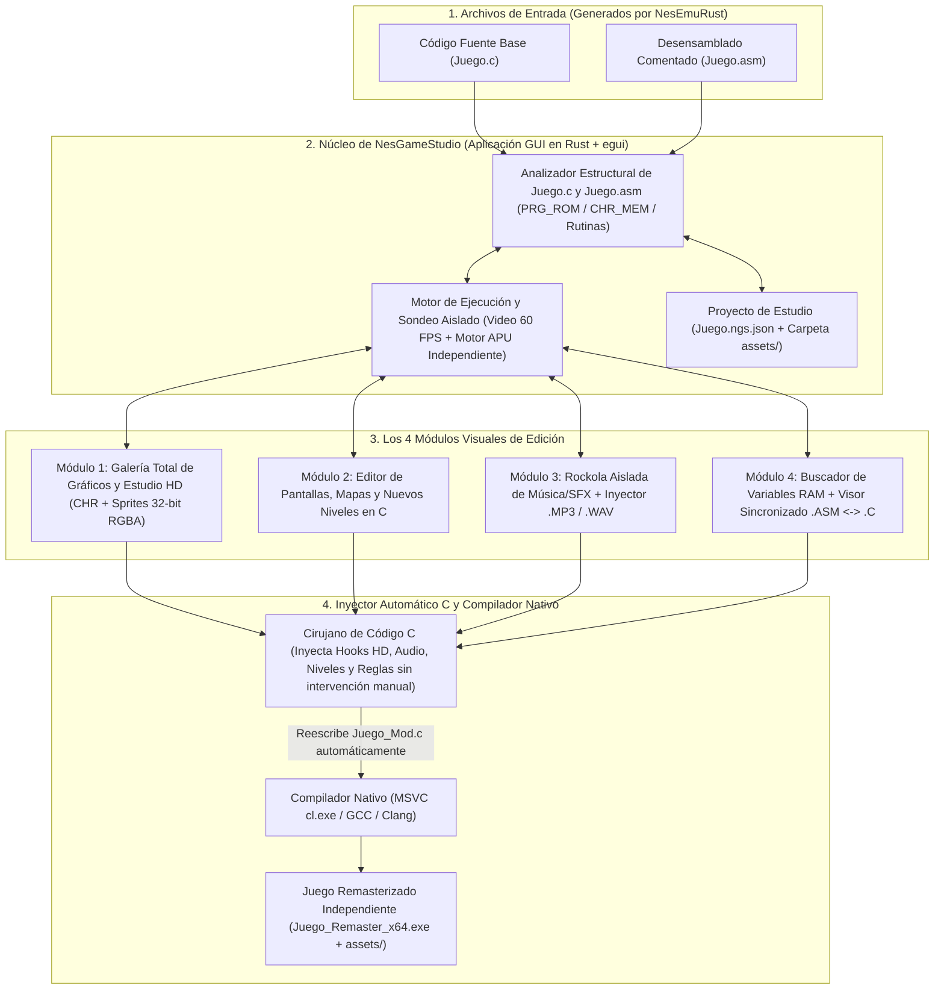
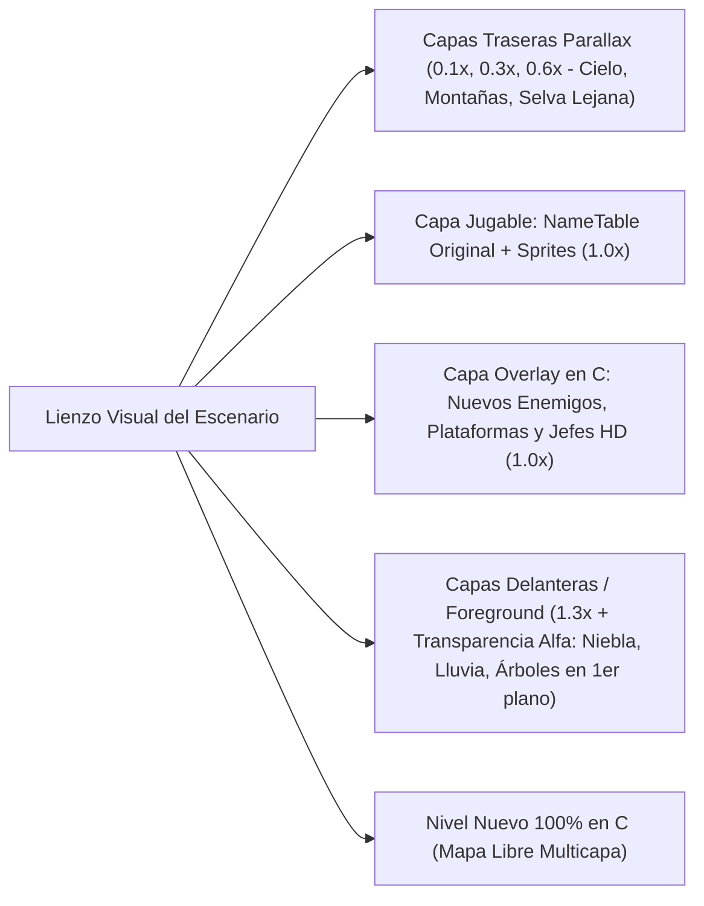
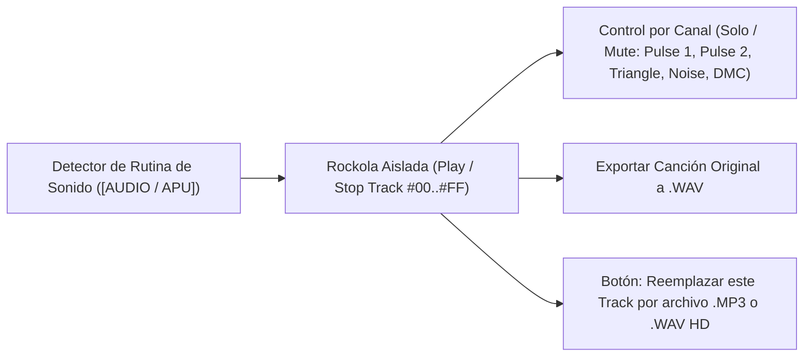
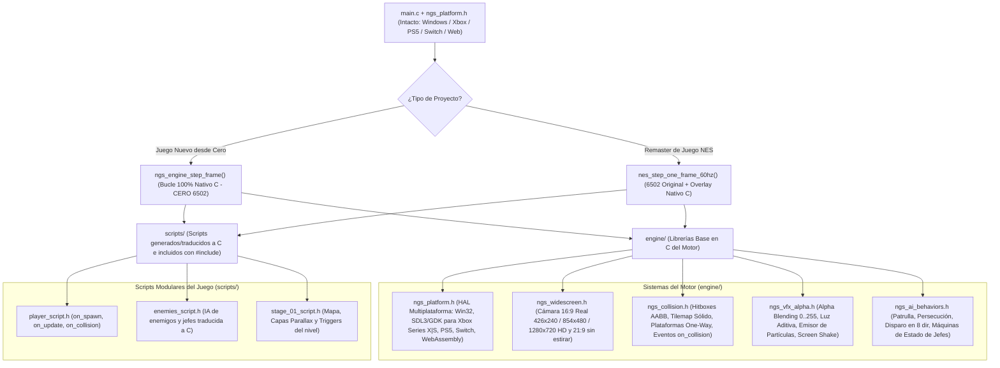
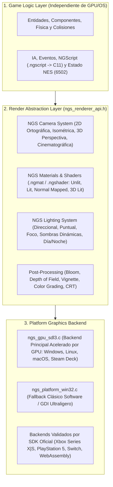

# `NesGameStudio` — Diseño Arquitectónico y Plan de Implementación

**`NesGameStudio`** es un entorno de desarrollo visual (IDE de Modding y Remasterización) independiente diseñado para cargar los archivos **`.c`** y **`.asm`** generados por [`NesEmuRust`](https://github.com/iztaneo/NesEmuRust), permitiendo transformar, expandir y modernizar cualquier juego clásico de NES en un juego nativo de PC (**x86/x64**) de alta calidad **de forma 100% visual, sin tener que entender ni editar manualmente código C ni ensamblador 6502**.

---

## 1. Filosofía y Arquitectura de Lenguaje Base (Híbrida: Rust + C)

### 1.1. Decisión de Lenguaje Base: **Arquitectura Híbrida (Editor en Rust + Juegos Generados en C)**
Para obtener la máxima productividad en la interfaz gráfica y la máxima velocidad de compilación en los juegos finales, **`NesGameStudio`** utiliza un modelo híbrido de dos capas:

| Capa del Sistema | Lenguaje y Tecnologías Base | Justificación Técnica |
| :--- | :--- | :--- |
| **1. El Editor / IDE Visual (`NesGameStudio`)** | **Rust (`Edition 2021`)** + `eframe`/`egui` (GUI), `cpal` (Audio en vivo), `image` (Carga `.PNG`/`.BMP`), `serde_json` (Proyectos `.ngs.json`) | Permite reutilizar directamente los núcleos de CPU, PPU y APU de `NesEmuRust` para la Vista Previa y la Rockola Aislada, manipular archivos de código `.c`/`.asm` de decenas de miles de líneas con seguridad de memoria absoluta y construir paneles visuales complejos rápidamente. |
| **2. El Motor de los Juegos Exportados (`Runtime Target`)** | **C Estándar Puro (`C99/C11`)** + `Win32 API` (`user32.lib`, `gdi32.lib`, `winmm.lib`) compilado vía `cl.exe /O2`, `gcc` o `clang` | El código que `NesGameStudio` inyecta o genera desde cero es **100% C puro sin dependencias externas**. Compila en ~1 segundo a un ejecutable `.exe` nativo ultraligero (`< 2 MB`) que corre en cualquier PC Windows sin instalar runtimes. |

### 1.2. Edición 100% Visual e Inyección Automática en C
- **El usuario nunca necesita editar código a mano**: Todas las mejoras (gráficos HD, capas Parallax, niveles, música `.MP3`/`.WAV` y reglas del juego) se realizan mediante herramientas visuales (pinceles, selectores de archivos, reproductor de música y lienzos de mapas), y **`NesGameStudio` modifica y recompila el archivo `.c` automáticamente por detrás**.
- **Exploración Total de Recursos**: Al abrir un juego (`.c` / `.asm`), `NesGameStudio` permite **visualizar todos los gráficos del juego** en una galería interactiva y **reproducir aisladamente cada canción y efecto de sonido** del juego en una rockola integrada (*Sound Test / Jukebox*).

---

## 2. Diagrama de Arquitectura de `NesGameStudio`



---

## 3. Diseño Detallado de los 4 Módulos Principales

### Módulo 1: Galería Completa de Gráficos y Estudio HD (`🎨 Todos los Gráficos y Sprites HD`)
Permite **visualizar y editar todos los gráficos contenidos en el juego** sin ver un solo número hexadecimal:

1. **Explorador Completo de Bancos Gráficos (*Full Game Graphic Browser*)**:
   - **Juegos con `CHR-ROM`** (*Super Mario Bros.*, *Mario 3*, *Castlevania*, etc.): Al abrir el archivo `.c`, `NesGameStudio` decodifica inmediatamente **todos los bancos de `CHR_MEM[]`** y muestra una galería completa con todos los personajes, enemigos de todos los niveles, jefes, objetos y bloques del juego sin necesidad de jugar hasta ese nivel.
   - **Juegos con `CHR-RAM`** (*Contra*, *Zelda*, *Mega Man*): Combina un escáner de patrones gráficos dentro de `PRG_ROM[]` con un **Catálogo de Capturas por Nivel**, permitiendo explorar y guardar en la galería todas las hojas de sprites descomprimidas de cada fase.
   - **Selector de Paletas y Armador de Metasprites**: Permite alternar entre todas las paletas de colores detectadas en el juego y ver los personajes completos (`16×32`, `32×32`) armados a partir de sus bloques de `8×8` u `8×16`.
2. **Edición Visual y Reemplazo por Gráficos HD (32-bit RGBA)**:
   - **Modo Pixel Art (8-bit)**: Pincel visual y botón **"Exportar / Importar `.BMP`"** para editar en Paint, GIMP o Aseprite.
   - **Modo Remaster HD (16×16 / 32×32 TrueColor)**: Seleccionas cualquier sprite o bloque en la galería y eliges una imagen `.PNG` / `.BMP` de **32 bits (16.7 millones de colores + transparencia alfa)**.
3. **Inyección Automática en el `.c` y Soporte Widescreen 16:9 / 21:9 Real**:
   - `NesGameStudio` modifica automáticamente `ppu_render_scanline()` en el archivo `.c`, amplía el `FRAMEBUFFER` y permite elegir entre relación **4:3 Clásica (`256×240` / `512×480` / `1024×960`)** o **Widescreen 16:9 Real sin estirar (`426×240` / `854×480` / `1280×720`)** y **21:9 Ultrawide**.
   - En modo **Widescreen 16:9 Real**, el motor renderiza `85 píxeles` adicionales reales a cada lado desde las *NameTables* adyacentes y extiende las capas *Parallax*, manteniendo las barras de estado (HUD) centradas y permitiendo que los sprites y enemigos se dibujen en los márgenes laterales sin desaparecer a los 256 píxeles.

---

### Módulo 2: Editor de Pantallas y Creador de Niveles (`🗺️ Pantallas y Niveles C`)
Permite editar los escenarios existentes o agregar niveles completamente nuevos con el mouse:



1. **Sistema de Profundidad Multicapa (*Unlimited Parallax & Foreground Layers*)**:
   - La NES original solo soportaba **1 capa de fondo** sin transparencia real. En `NesGameStudio` puedes agregar **múltiples capas de profundidad superpuestas** (tanto detrás del escenario como delante del jugador):
     - **Capas de Fondo (*Back Parallax*, velocidad `0.0x` a `0.9x`)**: Se dibujan automáticamente detrás de los píxeles transparentes (`pixel == 0`) del escenario original, desplazándose de forma suave según la cámara acumulada del juego (`camera_world_x * factor_parallax`).
     - **Capas de Primer Plano (*Foreground + Alpha Blending*, velocidad `1.1x` a `2.0x`)**: Se dibujan **por encima de los sprites y del escenario** usando canal Alfa de 32 bits (`RGBA`), permitiendo efectos modernos como neblina translúcida, lluvia, haces de luz (*god rays*), columnas o follaje que pasa frente a la cámara.
2. **Editor Visual de Pantallas (`NameTables` + Atributos)**:
   - Muestra el escenario como un lienzo interactivo donde tomas bloques de la Galería Gráfica y los pintas directamente sobre el mapa.
3. **Capa de Expansión en C (*Entity Overlay*)**:
   - Arrastras y sueltas **nuevos objetos, plataformas móviles, torretas o jefes HD** sobre cualquier nivel existente.
   - `NesGameStudio` escribe automáticamente las estructuras en C (`struct CustomEntity`), su física en punto flotante (`float`) y sus colisiones dentro del `.c`.
4. **Creador de Niveles Nuevos (*Custom Stages*) y Selector de Modo de Scrolling (`engine/ngs_scroll_camera.h`)**:
   - Diseñador de niveles desde cero sin el límite de 2 KB de RAM ni de 4 colores de la NES, donde eliges el tipo de desplazamiento de cámara con un clic:
     - **Scroll Horizontal (`SCROLL_HORIZONTAL`)**: Clásico de plataformas y *Run & Gun* (con opción de avance libre o bloqueo de retroceso estilo *Contra* / *Super Mario Bros.*).
     - **Scroll Vertical (`SCROLL_VERTICAL`)**: Ascendente o descendente (para etapas verticales tipo *Ice Climber*, Fase 3 de *Contra* o *Shoot 'em ups* verticales como *1942*), con capas *Parallax* verticales (`camera_world_y * factor_parallax`).
     - **Auto-Scroll Programable (`SCROLL_AUTO_PATH`)**: La cámara avanza sola siguiendo una ruta o velocidad variable para niveles de naves o persecuciones.
     - **Scroll Libre en 8 Direcciones (`SCROLL_FREE_8WAY` — RPG Top-Down y Metroidvania)**: El mapa puede medir cientos de pantallas a lo ancho y alto; la cámara sigue al jugador suavemente (*Camera Lerp + Deadzone*) y se detiene automáticamente en los bordes de cada habitación o ciudad (*Camera Bounds*), con soporte para puertas de teletransporte (*Warp Tiles*) hacia interiores de casas, tiendas o calabozos.

---

### Módulo 3: Rockola Aislada de Música/Efectos e Inyector `.MP3` / `.WAV` (`🎵 Sound Test & Audio Studio`)
Permite **escuchar aisladamente cada canción y efecto de sonido del juego** y reemplazarlos con un clic:



1. **Reproductor Aislado de Música y Efectos (*Standalone Sound Test / Jukebox*)**:
   - `NesGameStudio` localiza las subrutinas clasificadas como `[AUDIO / APU]` en el `.asm`/`.c` y ejecuta el motor de sonido del juego **en un entorno aislado (sin correr el resto del juego)**.
   - Muestra una lista de pistas (`Track #00`, `Track #01`, `Track #02`...) con botones **▶️ Play**, **⏸️ Pausa** y **⏹️ Stop** para que puedas escuchar aisladamente cada canción de nivel, música de jefe o efecto de disparo/explosión.
   - Incluye botones **Solo / Mute por cada uno de los 5 canales** (`Pulse 1`, `Pulse 2`, `Triangle`, `Noise`, `DMC`), visualizador de ondas/notas en vivo y opción para **exportar cualquier canción o efecto original del juego a un archivo `.WAV`**.
2. **Reemplazo Visual por `.MP3` o `.WAV` de Alta Calidad**:
   - Al escuchar una pista en la rockola (por ejemplo, descubres que el `Track #01` es la música de la Jungla en *Contra* y el `Track #12` es el sonido del disparo), simplemente haces clic en **"🔁 Reemplazar esta pista por `.MP3` / `.WAV`"**.
   - Eliges tu archivo `.mp3` o `.wav` del disco y `NesGameStudio` inyecta automáticamente en el código `.c` el interceptor que silencia esa pista de 8 bits y reproduce tu archivo `.mp3` (vía `mciSendStringA`) o mezcla tu `.wav` polifónico a `44.1 kHz` cuando el juego solicite ese sonido.

---

### Módulo 4: Buscador de Variables RAM y Modificador Visual de Reglas (`🔍 Variables y Reglas`)
Permite cambiar vidas, armas, velocidades, gravedad o trucos mediante controles visuales:

1. **Escáner de Variables en Tiempo Real (*Variable Finder*)**:
   - Filtras valores (`3` vidas -> `2` vidas) en la vista previa y descubres al instante qué casilla de `RAM[]` controla cada elemento del juego.
2. **Panel de Reglas y Trucos sin Código**:
   - Le asignas un nombre (`VIDAS_JUGADOR`, `ARMA_ACTUAL`) y defines reglas con menús desplegables (*"Valor inicial = 30"*, *"Congelar siempre en Spread Gun"*, *"Al presionar tecla C dar invencibilidad"*).
   - `NesGameStudio` inyecta automáticamente ese código C en `nes_step_one_frame_60hz()`.
3. **Visor Sincronizado `.ASM` <-> `.C` (Radiografía Opcional)**:
   - Muestra lado a lado el ensamblador y el código C generado con casillas para activar/desactivar instrucciones específicas con un clic.

### Módulo 5: Creador de Juegos Nuevos desde Cero (`🚀 Motor Nativo Sin 6502, Colisiones, VFX, IA y Multiplataforma`)
Convierte a `NesGameStudio` en un **"Mini-Unity" especializado en juegos 2D / 2.5D Retro y HD**.

> [!IMPORTANT]
> **¿Usa el procesador 6502 un juego nuevo creado desde cero?**  
> **NO.** Cuando creas un juego nuevo en `NesGameStudio`, **se elimina por completo la CPU 6502 (`switch(pc)`, registros `A, X, Y` y RAM de 2 KB)**. El juego corre sobre un **Bucle Propio 100% Nativo de `NesGameStudio` en C moderno (`ngs_engine_step_frame`)**, usando variables `float`, estructuras limpias (`NgsEntity`, `NgsWorld`) y memoria libre de 64 bits. *(El núcleo 6502 solo se incluye cuando abres un juego comercial antiguo de NES para modificarlo).*



0. **Bucle Propio de `NesGameStudio` para Juegos Nuevos (`ngs_engine_step_frame`)**:
   - En lugar de simular ciclos de un procesador de 1983, ejecuta 7 pasos limpios en C cada `16.6 ms` (`60 FPS`):
     1. `ngs_input_poll()` — Lee mandos modernos (Teclado, Xbox, DualSense PS5).
     2. `ngs_camera_update()` — Calcula el encuadre Widescreen `16:9` / `21:9` y los desplazamientos de las capas *Parallax*.
     3. `ngs_scripts_update()` — Ejecuta los scripts `on_update()` del jugador, enemigos y jefes.
     4. `ngs_physics_and_collisions()` — Aplica velocidades en `float`, gravedad, colisión con el mapa (`SOLID`, `ONE_WAY`) y cajas `AABB`, disparando `on_collision()`.
     5. `ngs_vfx_update()` — Actualiza partículas, luces aditivas, transparencias alfa (`0..255`) y temblor de cámara.
     6. `ngs_render_scene_hd()` — Compone todas las capas *Parallax*, sprites HD y *Foreground* en el `FRAMEBUFFER`.
     7. `ngs_audio_mix()` — Mezcla pistas `.MP3`/`.WAV` y efectos *chiptune* opcionales.

1. **Lenguaje Propio de Comportamiento (`NGScript` / `.ngscript`) Transpilado Automáticamente a C (Sin tocar `main.c`)**:
   - Para que no tengas que lidiar con punteros de C (`*`), cabeceras ni errores de sintaxis, **crearemos nuestro propio lenguaje declarativo de comportamiento (`NGScript`)** que puede editarse como texto ultra-simple o mediante bloques visuales en el estudio.
   - **¿Cómo funciona por dentro?** `NesGameStudio` incluye un **Transpilador (`NGScript -> C99`)**: tú escribes en `.ngscript`, y al guardar, el estudio traduce tu lógica a un archivo `.h` en C optimizado (`scripts/jefe_alien.h`) y actualiza automáticamente la tabla maestra `scripts/ngs_scripts_registry.h`. **El bucle del juego en `main.c` jamás se toca a mano**.
   - **Ejemplo de lo que escribes en `NGScript` (`jefe_alien.ngscript`)**:
     ```text
     entidad JefeAlien (vida = 100, capa = ENEMIGO) {
         estado PATRULLA {
             mover_x(velocidad = 1.5, rebotar_en_pared = true)
             cada 90 frames:
                 disparar("BalaPlasma", hacia = JUGADOR, velocidad = 4.0)
             si vida < 50:
                 iniciar_escena("cutscene_jefe_furia")
                 cambiar_estado(FURIA)
         }

         estado FURIA {
             transparencia(160)
             luz_dinamica(radio = 80, color = ROJO)
             perseguir(JUGADOR, velocidad = 2.8)
         }

         al_colisionar_con(BALA_JUGADOR, proyectil):
             restar_vida(proyectil.dano)
             efecto_particulas("chispas", x, y)
             destruir(proyectil)
             si vida <= 0:
                 efecto_explosion_hd(x, y)
                 desbloquear_logro("CAZADOR_DE_ALIENS")
                 destruir(este)
     }
     ```
   - **Lo que `NesGameStudio` genera e incluye solo en `scripts/jefe_alien.h`**:
     - Genera las funciones `jefe_alien_on_update(NgsEntity* self)` y `jefe_alien_on_collision(NgsEntity* self, NgsEntity* other)` y las registra automáticamente en el arreglo de punteros a función `g_entity_vtable[]` dentro de `scripts/ngs_scripts_registry.h`.

2. **Sistema de Detección de Colisiones Automático (`engine/ngs_collision.h`) — Sin tocar el Bucle Principal**:
   - El bucle principal (`ngs_engine_step_frame()`) llama siempre a `ngs_physics_and_collisions()`, el cual resuelve **3 niveles de colisión de forma automática en cada frame (60 FPS)**:
     1. **Colisión Entidad vs. Mapa (*Tilemap Grid Collider — O(1)*)**:
        - En el editor pintas sobre el escenario una máscara invisible con el tipo de cada bloque: `SOLID` (pared/piso), `ONE_WAY` (plataforma atravesable desde abajo estilo *Contra*), `SLOPE_45` (rampa/escalera diagonal), `LADDER` (escalera), `WATER` (agua) o `WARP_DOOR` (puerta a otro mapa/tienda RPG).
        - El motor detiene la caída por gravedad al pisar `SOLID`/`ONE_WAY`, empuja al personaje fuera de las paredes y activa el flag `self->on_ground = 1`.
     2. **Colisión Entidad vs. Entidad (*AABB Hitbox / Hurtbox + Capas de Máscara*)**:
        - En el editor dibujas dos rectángulos sobre cada sprite:
          - 🟩 **`Hurtbox` (Caja Vulnerable)**: dónde puede recibir daño o recoger ítems.
          - 🟥 **`Hitbox` (Caja de Ataque)**: el filo de una espada, un proyectil o el cuerpo de un enemigo.
        - Cada entidad pertenece a una **Capa (`LAYER_PLAYER`, `LAYER_ENEMY`, `LAYER_PLAYER_BULLET`, `LAYER_ENEMY_BULLET`, `LAYER_ITEM`, `LAYER_NPC`)**. El motor compara únicamente las capas que deben chocar entre sí y, cuando dos rectángulos se intersectan:
          ```c
          if (ngs_aabb_overlap(a->hitbox_world, b->hurtbox_world)) {
              // Despacha automáticamente al script traducido de A y de B sin tocar main.c:
              g_entity_vtable[a->script_id].on_collision(a, b);
              g_entity_vtable[b->script_id].on_collision(b, a);
          }
          ```
     3. **Zonas de Trigger / Sensores Invisibles (*Scene & RPG Triggers*)**:
        - Rectángulos invisibles que colocas en el mapa (ej. *"Zona de entrada al Jefe"* o *"Mostrador del Vendedor RPG"*). Al entrar el jugador en ese rectángulo, el motor dispara automáticamente el diálogo (`ngs_start_dialogue("mercader_01")`) o la escena cinemática (`ngs_play_cutscene("intro_jefe")`).

3. **Efectos Visuales, Transparencias, Iluminación Dinámica 2D y Efectos Programables en `NGScript` (`engine/ngs_vfx_alpha.h` + `ngs_lighting.h` + `scripts/vfx_*.h`)**:
   - **Transparencia Real (`Alpha Blending 0..255`)**: Cualquier sprite, capa Parallax o neblina tiene una propiedad `alpha` (`0` = invisible, `128` = 50% translúcido, `255` = opaco) mezclada por canal `RGBA` de 32 bits.
   - **Iluminación Dinámica 2D y Sombras en Tiempo Real (`ngs_lighting.h`)**: Permite colocar fuentes de luz dinámicas (antorchas, explosiones, faroles, ciclos de día/noche o proyectiles láser que iluminan el piso y las paredes conforme viajan en la oscuridad) con atenuación radial suave sobre el `FRAMEBUFFER` de 32 bits.
   - **Efectos Prehechos + Creación de Efectos Propios desde `NGScript` (`efecto_particulas` y `shader_2d`)**:
     - Además de los efectos listos para usar (`vfx_explosion`, `vfx_sparks`, `vfx_rain`, `vfx_screen_shake`), **puedes programar tus propios efectos visuales, magias RPG, estelas (*Afterimages*) y distorsiones de pantalla usando `NGScript`**, y el estudio los transpila a C nativo (`scripts/vfx_custom.h`):
     ```text
     // 1. Definir un emisor de partículas propio (ej. Hechizo de Fuego o Sangre/Chispas)
     efecto_particulas "FuegoMagico" {
         cantidad = 45
         velocidad = (1.5 .. 4.0), angulo = (0 .. 360)
         gravedad = -0.08               // Flota hacia arriba como brasas
         color = #FFCC00 -> #FF2200     // Transición de amarillo a rojo
         alfa = 255 -> 0, vida_frames = 40
         mezcla = ADITIVO               // Brillo intenso al superponerse
         luz_por_particula(radio = 18, color = #FF6600)
     }

     // 2. Definir un Shader 2D / Efecto de Post-Procesado por Scanline o Píxel
     shader_2d "OndasBajoElAgua" {
         para_cada_scanline(y):
             desplazar_x(y, sin(y * 0.12 + tiempo * 0.08) * 3.5)
             tinte_color(#80B0FF, fuerza = 0.25)
     }
     ```
     - También incluye la directiva `estela_fantasma(intervalo = 3, alfa_inicial = 180, tinte = #00FFFF)` en `NGScript` para crear el clásico efecto de sombras translúcidas al hacer *dash* o ataques especiales (estilo *Castlevania: Symphony of the Night* o *Mega Man X*).

4. **Inteligencia Artificial (IA) de Personajes y Jefes (`engine/ngs_ai_behaviors.h`)**:
   - **Comportamientos Preconstruidos Seleccionables**: Desde el editor puedes asignarle a cualquier enemigo una IA lista para usar sin escribir código:
     - `AI_PATROL_SMART`: Camina por una plataforma y da vuelta al detectar un borde o pared.
     - `AI_TURRET_SNIPER`: Calcula el ángulo hacia `(player.x, player.y)` y dispara proyectiles dirigidos cada `N` frames.
     - `AI_CHASER / JUMPER`: Persigue al jugador y salta obstáculos.
     - `AI_FLYING_WAVE`: Movimiento aéreo senoidal o en picada.
   - **Máquinas de Estado para Jefes (*Boss Scripting*)**: Permite encadenar fases visuales o por script (*"Fase 1: Dispara abanico -> Si `hp < 50%` -> Fase 2: Se vuelve semitransparente, tiembla la pantalla y embiste"*).

5. **Poderes de Tiempo: Rebobinado en Vivo (*Time Rewind*) y Cámara Lenta (*Bullet Time*) (`engine/ngs_time_control.h`)**:
   - **Buffer Circular de Estados (`600 frames` / 10 segundos)**: Como el estado completo del juego en C ocupa apenas unos kilobytes por frame, el motor guarda un historial continuo en memoria RAM.
   - **Time Rewind & Bullet Time**: Con activar una casilla en `NesGameStudio`, el jugador puede mantener presionado un gatillo o tecla para **rebobinar el tiempo en vivo** (con filtro visual tipo VHS) si cometió un error, o activar **Cámara Lenta (*Bullet Time* a `0.25x` / `0.5x`)** para esquivar lluvias de proyectiles.

6. **Editor de Animaciones (*Sprite Timeline*), Director de Escenas *In-Engine* (`engine/ngs_cutscenes.h`) y Sistema de Diálogos RPG (`engine/ngs_rpg_dialogue.h`)**:
   - **Línea de Tiempo de Animación (*Sprite Timeline*)**: Editor visual para armar secuencias de cuadros (*Idle, Correr, Saltar, Disparar, Hablar, Morir*), ajustar la duración en milisegundos de cada cuadro, editar su *Hitbox* por frame y vincular en qué cuadro exacto se dispara un sonido o proyectil.
   - **Editor Visual de Diálogos Ramificados y Modo RPG (`engine/ngs_rpg_dialogue.h` + `scripts/rpg_dialogues.h`)**:
     - Permite diseñar conversaciones mediante **nodos conectados visualmente (*Dialogue Tree*)**: cada caja de texto incluye retrato animado del personaje (con cambios de expresión facial), efecto máquina de escribir con sonido por letra y **respuestas de opción múltiple (`Sí / No / Comprar / Aceptar misión`)**.
     - Soporta **Banderas de Historia y Condiciones (`Quest Flags`)** (ej. si `tiene_llave_antigua == 1`, el NPC te abre el templo; si no, te da una pista), además de tablas listas para **RPG**: estadísticas (`HP`, `MP`, `EXP`, `Nivel`, `Oro`), inventario de objetos, cofres y tiendas, más localización multi-idioma (`ES` / `EN`).
   - **Director de Escenas Generadas 100% con el Motor del Juego (*In-Engine Cutscene Sequencer*)**:
     - En lugar de insertar videos `.mp4` pregrabados que pesan cientos de megabytes y rompen la estética, las escenas cinemáticas **se ejecutan en tiempo real usando el propio motor del juego, el mismo mapa y los mismos sprites**:
       1. **Pista de Cámara**: Mueve la cámara suavemente de un punto a otro del escenario (`Camera Pan / Lerp`), aplica *Zoom*, activa barras negras de cine arriba y abajo (*Letterbox*) o sacude la pantalla (*Screen Shake*).
       2. **Pista de Actores (*Sprites*)**: Ordena en la línea de tiempo que el protagonista, los aliados o el jefe caminen de `(x1, y1)` a `(x2, y2)`, cambien de animación (ej. desenvainar espada, caer de rodillas), o muestren globos de emoción (`!`, `?`, `...`) sobre su cabeza.
       3. **Pista de Diálogos, Luz y Audio**: Dispara cajas de diálogo sincronizadas con los movimientos de los personajes, oscurece el ambiente o enciende luces dinámicas (`ngs_lighting.h`), lanza partículas (lluvia, relámpagos, explosiones) y cambia la música de fondo con *Fade-Out / Fade-In*.
     - Todo lo que armas en el editor visual se traduce automáticamente a un script declarativo en C (`scripts/cutscene_intro.h`, `scripts/cutscene_jefe.h`) incluido con `#include` sin tocar `main.c`.

7. **Generador de Efectos Retro (*Sfxr*) y *Piano Roll* Musical Integrado (en el Módulo 3)**:
   - **Generador de Sonidos en 1 Clic (*Sfxr Integrado*)**: Botones instantáneos (*"🔊 Generar Disparo"*, *"💥 Generar Explosión"*, *"🪙 Generar Moneda/Ítem"*, *"🦘 Generar Salto"*, *"⚡ Generar Láser"*) con deslizadores de tono, caída y vibrato que sintetizan nuevos efectos `.WAV` o secuencias APU dentro del estudio.
   - **Teclado y *Piano Roll* Chiptune**: Editor musical por notas para componer melodías nuevas desde cero sin programas externos.

8. **Multijugador de 2 a 4 Jugadores: Cooperativo Local y *Netplay* Online P2P (`engine/ngs_netplay.h`)**:
   - **Hasta 4 Mandos simultáneos**: Soporte para 2 a 4 jugadores en pantalla tanto en juegos nuevos como inyectando un compañero cooperativo en juegos clásicos.
   - **Netplay P2P Ligero (`winsock2.lib` UDP)**: Sincronización determinista de entradas (*Input Lockstep / Rollback ligero*) que permite jugar cooperativo en línea entre dos PCs enviando únicamente los bytes de botones de cada frame.

9. **Sistema de Logros (*Achievements*), Menú de Pausa *Overlay* Moderno y *Speedrun Timer* (`engine/ngs_overlay_ui.h`)**:
   - **Menú *Overlay* In-Game**: Inyecta en el ejecutable `.exe` un menú moderno al presionar `Esc` / `Start` con guardado/carga instantánea en múltiples ranuras, reconfiguración de controles y ajuste de volumen.
   - **Logros Desbloqueables y Cronómetro de Speedrun**: Permite definir logros visuales en el estudio (ej. *"Pasar el Nivel 1 sin perder vidas"* o *"Derrotar al Jefe en menos de 40s"*) que muestran una notificación animada en pantalla al cumplirse y guardan las medallas y récords de tiempo en disco.

10. **Plantillas de Género y Biblioteca Global de "Mashup"**:
    - Incluye plantillas base (*Run & Gun*, *Plataformas*, *Top-Down Aventura*, *Shoot 'em Up*) y permite combinar recursos extraídos de cualquier juego NES con gráficos HD y sonidos propios.

11. **Exportación Multiplataforma a PC, Consolas (`PS5`, `Xbox Series X|S`, `Switch`) y Web (`engine/ngs_platform.h`)**:
   - Como el 100% del motor gráfico (`FRAMEBUFFER[]` en RAM), física, colisiones, IA y mezclador de audio (`audio_frame_samples[]` en RAM) está escrito en **C99/C11 estándar puro sin dependencias del sistema operativo**, sólo la capa final de presentación (`engine/ngs_platform.h`) cambia según la plataforma destino:
     - **Windows Nativo (Sin DLLs externas)**: `Win32 GDI (StretchDIBits)` + `waveOut` + `XInput / joyGetPosEx`.
     - **Xbox Series X|S / Xbox One (GDK / UWP / Modo Desarrollador)**: Compila directamente con `MSVC` usando el backend `SDL2`/`SDL3` o `DirectX 12 + XAudio2 + GameInput`.
     - **PlayStation 5 / Nintendo Switch / Linux / Steam Deck / Android**: Compila con `Clang` usando el backend estándar `SDL2`/`SDL3` (ya soportado oficialmente en los SDKs de consola).
     - **Navegador Web (HTML5 / WebAssembly)**: Compila con `Emscripten` para correr directo en el navegador.

12. **Copiloto IA Universal Multi-Modelo y Tutor Educativo Integrado (`src/ai_copilot.rs`)**:
   - Incluye un panel lateral de **Asistente IA Agéntico** dentro de `NesGameStudio` capaz de conectarse a **cualquier proveedor de IA** mediante configuración visual (`Endpoint URL + API Key + Selector de Modelo`):
     - **Modelos en la Nube**: **Google Gemini** (`Gemini 2.5 Pro / Flash`), **Anthropic Claude**, **OpenAI (`GPT-4o / o3`)**, **DeepSeek**, **Groq** u **OpenRouter**.
     - **Modelos 100% Locales y Gratuitos (Sin internet ni costo de tokens)**: Conexión directa con **Ollama** (`http://localhost:11434`) o **LM Studio** (`http://localhost:1234`) usando modelos locales como `Qwen-2.5-Coder`, `DeepSeek-Coder` o `Llama-3`.
   - **¿Qué hace el Copiloto IA dentro de la herramienta (con mínimo gasto de tokens)?**
     - Como la IA escribe en nuestro lenguaje compacto **`NGScript`** (y no miles de líneas de C crudo), responde en segundos gastando poquísimos tokens:
       1. **Generador de Comportamientos y Jefes (`.ngscript`)**: Le pides *"Crea un jefe esqueleto que salte hacia el jugador, lance 3 huesos con gravedad y al morir suelte una llave"* y el Copiloto escribe el `.ngscript`, lo transpila a `scripts/*.h` y lo inyecta en vivo.
       2. **Escritor de Árboles de Diálogos RPG y Cinemáticas *In-Engine***: Genera conversaciones ramificadas completas con condiciones de misión (`Quest Flags`) y secuencias de cámara/actores para el Director de Escenas.
       3. **Diseñador de Efectos (`efecto_particulas` / `shader_2d`) y Sonidos (`Sfxr` / *Piano Roll*)**: Crea efectos visuales y melodías *chiptune* o parámetros de sonido a partir de una descripción en lenguaje natural.
       4. **Modo "Profesor / Tutor Interactivo" (Enfoque Educativo)**: Explica paso a paso a estudiantes o principiantes cómo funciona una rutina del juego, qué hace cada variable de la `RAM` o cómo se traduce su script `NGScript` a lenguaje C profesional (`struct`, punteros y memoria).

---

## 4. Especificación Arquitectónica: `NGS Hybrid Renderer` (Motor Gráfico 2D HD / 2.5D / Hybrid 2D-3D)

- **Componente**: `NGS Hybrid Renderer`
- **Lenguajes Principales**: `C11` (runtime exportado) + `Rust` (`egui`, editor visual)
- **Integración**: `NGS Engine` + `NesEmuRust Compatibility Layer` (`ngs_nes_adapter.c`)

### 4.1. Objetivo General y Principios Arquitectónicos
Desarrollar un motor gráfico híbrido, acelerado por GPU, que permita crear videojuegos 2D modernos y combinar sprites *pixel art* con escenarios tridimensionales (estética **HD-2D**), iluminación dinámica, efectos cinematográficos y renderizado de alta resolución, tanto para juegos creados desde cero como para juegos retro importados desde `NesEmuRust`.



- **Separación estricta entre lógica y representación**: La lógica del videojuego nunca depende directamente de DirectX, Vulkan, Metal, Win32 ni de un SDK de consola.
- **Backend Gráfico (`ngs_renderer_api.h`)**: Se adopta **SDL3 GPU** como primera implementación acelerada por hardware, manteniendo nuestra propia interfaz abstracta (`ngs_renderer_api.h`) para cambiar o agregar backends nativos validados con el SDK oficial de cada consola cerrada.

---

### 4.2. Los 3 Modos de Renderizado (`Classic 2D`, `Enhanced 2D`, `Hybrid 2D/3D`)

| Modo | Enfoque Visual | Características Clave | Objetivo |
| :--- | :--- | :--- | :--- |
| **Modo A: Classic 2D** | Tradicional con sprites y tilemaps | Pixel art sin interpolación, resoluciones retro, escalado entero, *sprite batching*, paletas originales y compatibilidad exacta con juegos reconstruidos. | Preservar la apariencia fiel de 8 bits cuando el usuario lo desee. |
| **Modo B: Enhanced 2D** | 2D moderno acelerado por GPU | Sprites HD y texturas RGBA, capas *parallax* multicapa, transparencias, iluminación 2D, **Normal Maps para sprites**, partículas, sombras, shaders y Widescreen `16:9` / `21:9`. | Remasterizar en 2D HD sin reconstruir toda la geometría del juego. |
| **Modo C: Hybrid 2D/3D (HD-2D)** | Sprites 2D integrados en escenarios 3D | Modelos y escenarios 3D, sprites como *billboards* o planos orientados con *depth buffer*, cámara en perspectiva/ortográfica, materiales iluminados, sombras proyectadas, efectos volumétricos, *Depth of Field* y posprocesamiento cinematográfico. | Crear juegos y remasters visualmente comparables a los referentes modernos **HD-2D**. |

---

### 4.3. Subsistemas del `NGS Hybrid Renderer`

1. **`NGS GPU Renderer` (`ngs_renderer_api.h`, `ngs_renderer_core.c`, `ngs_renderer_2d.c`, `ngs_renderer_3d.c`, `ngs_gpu_resources.c`)**:
   - Administración de texturas, buffers, renderizado de sprites con *batching*, geometría 3D, ordenamiento de capas, *render targets*, *depth buffers* y shaders.
2. **`NGS Lighting System` (`ngs_lighting.c`)**:
   - Luces direccionales, puntuales y de foco (*spotlights*) con atenuación por distancia, *normal maps* para dar relieve a sprites 2D, sombras dinámicas, luz ambiental y ciclos día/noche (con extensión a iluminación volumétrica y reflejos).
3. **`NGS Camera System` (`camera_editor.rs`)**:
   - Modos unificados: **2D Ortográfica**, **Isométrica**, **3D en Perspectiva**, **Seguimiento suave** y **Cinematográfica**, con posición, rotación, zoom, FOV, profundidad y puntos de interés editables.
4. **`NGS Materials & Shaders` (`ngs_materials.c`, `ngs_postprocess.c`)**:
   - Materiales base: *Pixel Art Unlit*, *Sprite Lit*, *Sprite Normal Mapped*, *Transparent*, *Additive* y *Standard 3D Lit*.
   - Posprocesamiento configurable: *Bloom*, *Vignette*, *Depth of Field*, *Color Grading*, *Distortion*, *Pixelation* y *CRT*.
5. **`NGS Scene Composer` (`scene_editor.rs`, `material_editor.rs`, `lighting_editor.rs`)**:
   - Editor visual de escenas híbridas integrado en `NesGameStudio` con manipuladores 3D/2D de posición, rotación y escala, inspector de materiales, luces, partículas y vista previa en tiempo real.
   - Formatos estructurados: `.ngs.json` (proyecto), `.ngscene` (escenas), `.ngmat` (materiales) y `.ngshader` (efectos).

---

### 4.4. Integración con `NesEmuRust` (`retro/ngs_nes_adapter.c`)
1. **Conservación de la lógica original**: Los juegos importados conservan su código 6502 recompilado a C, estados de CPU/memoria, interrupciones, sincronización y colisiones originales; el `NGS Hybrid Renderer` actúa como capa de presentación pura sin alterar el determinismo ni los tiempos del juego.
2. **Asociación y reemplazo de recursos**:
   - `Tile NES` → Textura HD o bloque 3D.
   - `Sprite NES` → Sprite HD con *Normal Map* o *Billboard* 2.5D.
   - `Fondo NES` → Escenario multicapa o escena 2.5D/3D.
   - `Efecto original` → Sistema de partículas e iluminación dinámica.
3. **Correspondencia con escenarios 3D**: Cuando una ROM no contenga información suficiente para inferir automáticamente un mundo 3D, el editor permite mapear manualmente las correspondencias de coordenadas, desplazamientos de cámara, habitaciones y eventos, manteniendo tres modos conmutables en tiempo real: **Original**, **Enhanced** y **Hybrid**.

---

## 5. Estructura del Repositorio (`NesGameStudio`)

```text
NesGameStudio/
├── Cargo.toml                  # Aplicación GUI en Rust (eframe/egui, rfd, serde, image, cpal)
├── README.md                   # Descripción general y arquitectura en Mermaid
├── PLAN_IMPLEMENTACION.md      # Este documento de diseño e implementación
├── templates/
│   └── engine/                 # Motor modular en C11 exportable
│       ├── render/
│       │   ├── ngs_renderer_api.h    # Interfaz gráfica abstracta independiente del OS/GPU
│       │   ├── ngs_renderer_core.c   # Inicialización, render targets, depth buffer y recursos GPU
│       │   ├── ngs_renderer_2d.c     # Modos Classic 2D y Enhanced 2D (sprite batching, parallax)
│       │   ├── ngs_renderer_3d.c     # Modo Hybrid 2D/3D (geometría 3D, billboards, perspectiva)
│       │   ├── ngs_materials.c       # Materiales (Unlit, Lit, Normal Mapped, 3D Lit)
│       │   ├── ngs_lighting.c        # Luces direccionales, puntuales, foco y sombras dinámicas
│       │   └── ngs_postprocess.c     # Bloom, Depth of Field, Vignette, Color Grading, CRT
│       ├── platform/
│       │   ├── ngs_platform.h        # HAL de plataforma, audio y controles
│       │   ├── ngs_gpu_sdl3.c        # Backend acelerado por GPU vía SDL3 GPU
│       │   └── ngs_platform_win32.c  # Backend ligero Win32
│       ├── retro/
│       │   └── ngs_nes_adapter.c     # Puente de compatibilidad y reemplazo visual para NesEmuRust
│       └── gameplay/
│           ├── ngs_scroll_camera.h   # Cámaras 2D/3D y Scrolling Horizontal, Vertical, Auto y 8-Way
│           ├── ngs_collision.h       # Colisiones AABB Hitbox/Hurtbox, Tilemap Grid O(1) y Triggers
│           ├── ngs_ai_behaviors.h    # Comportamientos de IA y máquinas de estado para Jefes
│           ├── ngs_rpg_dialogue.h    # Árboles de Diálogos, Misiones, Inventario y Tiendas RPG
│           ├── ngs_cutscenes.h       # Director de Cinemáticas In-Engine en tiempo real
│           ├── ngs_time_control.h    # Rebobinado en Vivo (Time Rewind) y Bullet Time
│           ├── ngs_netplay.h         # Cooperativo Local 2-4P y Netplay Online P2P UDP
│           └── ngs_overlay_ui.h      # Menú Overlay In-Game, Logros y Speedrun Timer
├── assets/
│   ├── textures/
│   ├── models/
│   ├── materials/              # Archivos .ngmat
│   └── shaders/                # Archivos .ngshader
├── scenes/
│   └── demo_hybrid.ngscene     # Escenas serializadas .ngscene
└── src/
    ├── main.rs                 # Ventana principal de NesGameStudio
    ├── project.rs              # Proyecto (.ngs.json), catálogo de pistas y carpeta assets/
    ├── ai_copilot.rs           # Conector Universal Multi-Modelo IA (Gemini, Claude, OpenAI, Ollama Local)
    ├── parser/                 # Analizador y re-escritor automático de archivos .c y .asm
    ├── transpiler/             # Transpilador de nuestro lenguaje NGScript (.ngscript -> scripts/*.h)
    ├── runtime/                # Motor de vista previa a 60 FPS y Rockola APU aislada
    ├── editors/
    │   ├── graphics.rs         # Módulo 1: Galería total de gráficos CHR, Sprites HD y Timeline
    │   ├── levels.rs           # Módulo 2: Editor de Mapas, Scrolling, Parallax, RPG y Cutscenes
    │   ├── scene_editor.rs     # NGS Scene Composer (Escenas Híbridas 2D/3D y Billboards)
    │   ├── material_editor.rs  # Inspector de Materiales (.ngmat) y Normal Maps
    │   ├── lighting_editor.rs  # Editor de Luces 2D/3D, Sombras y Ciclos Día/Noche
    │   ├── camera_editor.rs    # Editor de Cámaras Ortográficas, Isométricas y Perspectiva 3D
    │   ├── audio.rs            # Módulo 3: Rockola aislada, Generador Sfxr, Piano Roll y .MP3/.WAV
    │   └── ram_inspector.rs    # Módulo 4: Buscador de Variables RAM, Reglas y Visor .ASM <-> .C
    └── codegen/                # Empaquetador de scripts/*.h y compilador automático a .exe nativo
```

---

## 6. Hoja de Ruta Unificada: Fases Base + Fases `NGS Hybrid Renderer` (`HD-01` a `HD-07`)

### 6.1. Fases del IDE Base, Motor de Juego y `NGScript`

| Fase | Qué construimos | Tiempo Estimado | Consumo de Tokens Estimado | Por qué es rápido |
| :--- | :--- | :---: | :---: | :--- |
| **Fase 1: Base del IDE, Galería Gráfica y Rockola Aislada** | Ventana `egui`, lector de `.c`/`.asm`, visor de todos los sprites (`CHR`) y reproductor aislado de música/efectos (*Sound Test* + `.WAV`). | **~35 - 45 min** | 🟢 **Bajo (~40k - 60k)** | Reutilizamos directamente la PPU y APU que ya programamos en `NesEmuRust`. |
| **Fase 2: Motor Gameplay C (`gameplay/*.h`) y Abstracción `HD-01`** | `ngs_renderer_api.h`, cámara `16:9`, Scroll Horizontal/Vertical/8-Way, Colisiones (`AABB` + Mapa) y separación respecto a Win32/GDI. | **~45 - 55 min** | 🟢 **Bajo-Medio (~65k - 85k)** | Cabeceras `.h`/`.c` independientes en C11 (~150 líneas cada una). |
| **Fase 3: Lenguaje `NGScript`, Transpilador a C y Copiloto IA** | El traductor de `.ngscript` a `scripts/*.h` (IA, estados, colisiones, efectos propios) + conector IA (`src/ai_copilot.rs`). | **~45 - 55 min** | 🟡 **Medio (~70k - 90k)** | Parser declarativo compacto en Rust (~300 líneas). |
| **Fase 4: Editor de Mapas, Diálogos RPG, Cinemáticas *In-Engine* y `Sfxr`** | Lienzo para pintar niveles/triggers, editor de diálogos RPG, línea de tiempo de escenas con el motor y generador de sonidos retro. | **~45 - 55 min** | 🟡 **Medio (~80k - 110k)** | Cada herramienta visual vive en su propia pestaña modular de `egui`. |
| **Fase 5: *Time Rewind*, Cooperativo 4P/Netplay, Logros y Compilación** | Rebobinado en vivo, *Bullet Time*, logros en pantalla y empaquetado `.exe`. | **~30 - 40 min** | 🟢 **Bajo (~40k - 60k)** | Conecta los módulos de gameplay y empaqueta el ejecutable final. |

### 6.2. Fases del Motor Gráfico `NGS Hybrid Renderer` (`HD-01` a `HD-07`)

| Fase HD | Prioridad | Actividades Principales | Criterio de Aceptación |
| :--- | :---: | :--- | :--- |
| **Fase HD-01: Abstracción Gráfica y Renderizador GPU** | 🔴 Crítica | Definir `ngs_renderer_api.h`, separar GDI de la lógica, integrar backend `SDL3 GPU`, *sprite batching* y conservar modo clásico. | Escena de prueba a 60 FPS sin dependencias directas de Win32 en la lógica del juego. |
| **Fase HD-02: Enhanced 2D** | 🟠 Alta | Texturas HD RGBA, transparencias, *parallax*, iluminación 2D, *normal maps* para sprites, materiales y partículas. | Escena 2D HD multicapa con iluminación dinámica y *normal maps* editable desde `NesGameStudio`. |
| **Fase HD-03: Renderizado Híbrido 2D/3D (HD-2D)** | 🟠 Alta | Geometría 3D, cámaras en perspectiva, sprites como *billboards* con profundidad, *depth buffer*, materiales iluminados y sombras proyectadas. | Escena con personajes pixel art sobre geometría 3D, iluminación dinámica y sombras coherentes. |
| **Fase HD-04: Editor Visual Híbrido (`NGS Scene Composer`)** | 🟠 Alta | Editor de escenas 3D (`scene_editor.rs`), manipuladores de transformación, inspector de materiales, luces, cámaras y serialización `.ngscene`. | Crear, guardar, reabrir y compilar una escena híbrida completa sin modificar código C a mano. |
| **Fase HD-05: Integración Retro (`ngs_nes_adapter.c`)** | 🟠 Alta | Conectar renderizador con `NesEmuRust`, perfiles de reemplazo HD/3D, sincronizar cámaras y conmutar modos *Original / Enhanced / Hybrid*. | Recompilar una ROM de prueba legalmente distribuible y presentar su versión híbrida manteniendo lógica idéntica. |
| **Fase HD-06: Efectos Cinematográficos y Optimización** | 🟡 Media | *Bloom*, *Depth of Field*, *Color Grading*, efectos atmosféricos, reducción de *draw calls*, perfiles gráficos y *profiling* CPU/GPU. | Calidad visual configurable a 1080p / 60 FPS sin fugas de memoria GPU entre escenas. |
| **Fase HD-07: Backends Multiplataforma** | 🔵 Posterior | Consolidar `ngs_renderer_api.h`, adaptar pipeline de shaders y validar en Windows, Linux, macOS, Steam Deck, WebAssembly y SDKs de consolas. | Compilar y ejecutar el mismo proyecto en al menos dos plataformas de escritorio y dejar listo el puente para consolas. |

---

## 7. Requisitos de Rendimiento, Mitigación de Riesgos y Ahorro de Tokens

### 7.1. Presupuestos de Calidad y Rendimiento
- **Objetivo base**: `60 FPS` estables a `1080p` en el equipo de referencia, desacoplando la frecuencia de actualización lógica (`60 Hz` deterministas) de la frecuencia de refresco del monitor.
- **Gestión GPU**: Reducción de *draw calls* por *batching*, carga diferida de recursos, perfiles de calidad escalables (*Low / Medium / High / Ultra HD-2D*) y telemetría de tiempos de CPU y GPU por frame.

### 7.2. Matriz de Riesgos Técnicos y Mitigación

| Riesgo Técnico | Estrategia de Mitigación |
| :--- | :--- |
| **Acoplamiento con Win32/GDI** | Introducir `ngs_renderer_api.h` desde el inicio (`Fase HD-01`) antes del nuevo renderizador. |
| **Incompatibilidad entre shaders** | Definir un pipeline portable (`.ngshader`) que genere variantes para los backends objetivo. |
| **Diferencias de sincronización NES** | Separar estrictamente la simulación lógica 6502/C de la capa de presentación GPU. |
| **Reconstrucción incorrecta de escenarios retro en 3D** | Permitir mapeo manual explícito en el editor y registrar niveles de confianza por escena. |
| **Alto costo de efectos cinematográficos** | Implementar perfiles de calidad configurables y presupuestos GPU por plataforma. |
| **Dependencia de SDK propietarios de consolas** | Mantener backends independientes detrás de `ngs_renderer_api.h`. |
| **Regresiones del código recompilado** | Ejecutar pruebas comparativas deterministas entre modo *Original* y modo *Hybrid*. |

### 7.3. Estrategia para Ahorrar hasta un 65% de Tokens Durante el Desarrollo
1. **Archivos Pequeños y Modulares (Máximo ~200 líneas por archivo)**: Cada subsistema de `templates/engine/render/` y `templates/engine/gameplay/` vive en su propio archivo `.h`/`.c` independiente.
2. **Trabajar directamente sobre el Workspace de `NesGameStudio`**: Tomar este [`PLAN_IMPLEMENTACION.md`](PLAN_IMPLEMENTACION.md) como especificación maestra en cada sesión.
3. **Compactar o Iniciar Sesión Limpia al Concluir cada Fase**: Hacer `git commit` + `git push` al terminar cada fase y usar `/compact` para no arrastrar historial innecesario.
