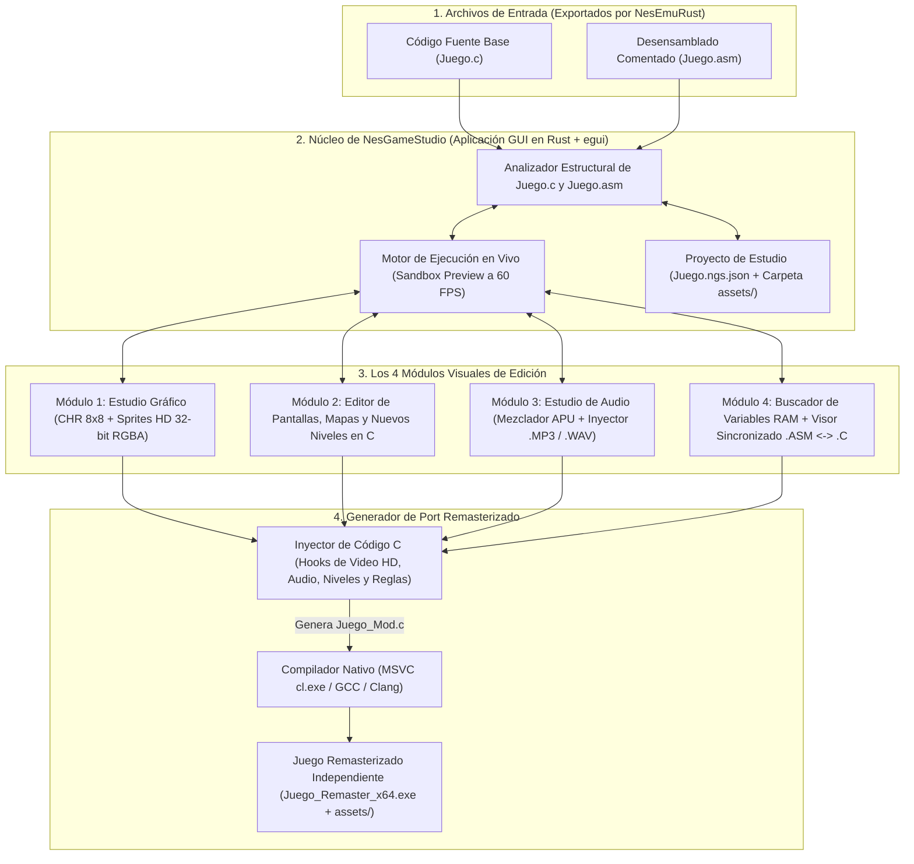
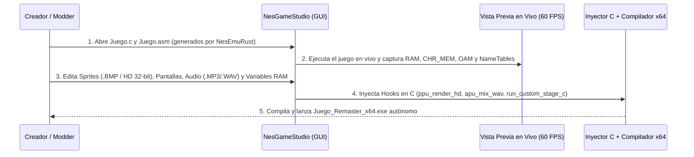

# NesGameStudio — IDE Visual de Edición, Modding y Remasterización HD para Juegos NES en C

**`NesGameStudio`** es un entorno de desarrollo visual (IDE) independiente diseñado para cargar los archivos **`.c`** y **`.asm`** generados por el recompilador estático de [**`NesEmuRust`**](https://github.com/iztaneo/NesEmuRust).

Su propósito es permitir **visualizar, editar, modernizar y expandir** cualquier juego clásico de NES traducido a C (cambiando sprites a alta definición de 32 bits, editando pantallas, creando niveles nuevos en C puro, inyectando música `.MP3` / efectos `.WAV` y modificando reglas de juego) **sin tener que programar en ensamblador 6502 ni editar arreglos hexadecimales a mano**.

---

## Arquitectura General de `NesGameStudio`

---

## Los 4 Módulos Principales

| Módulo | Función Principal | Qué Evita Hacer a Mano |
| :--- | :--- | :--- |
| **1. Estudio Gráfico (`🎨 Sprites & HD Packs`)** | Decodifica `CHR_MEM` y `OAM` en vivo como mapas de bits visibles, permite pintar píxeles, exportar/importar `.BMP` y reemplazar tiles de `8×8` (4 colores) por **Sprites HD (`16×16` / `32×32` RGBA de 32 bits)**. | Editar bytes hexadecimales (`0x3C, 0x7E...`) o lidiar con planos de 2 bits. |
| **2. Editor de Pantallas y Niveles (`🗺️ Escenarios & Niveles C`)** | Lienzo visual tipo *Tiled* para editar pantallas existentes (`NameTables`), superponer nuevas entidades/enemigos en C (*Overlay*) o diseñar **niveles nuevos 100% en C**. | Descifrar punteros comprimidos de mapas en `PRG_ROM` o límites de 2 KB de RAM. |
| **3. Estudio de Audio (`🎵 APU + .MP3 / .WAV`)** | Silencia selectivamente canales 8-bit de la APU y asocia pistas **`.MP3`** (música de fondo) y efectos **`.WAV`** polifónicos a eventos o cambios de `RAM`. | Programar llamadas a `winmm.lib` o rastrear rutinas de sonido en ensamblador. |
| **4. Inspector RAM y Visor `.ASM` <-> `.C` (`🔍 Símbolos & Reglas`)** | Escáner de memoria en vivo para descubrir qué casilla de `RAM` guarda vidas, armas o coordenadas `(X, Y)`, renombrarlas a `#define` legibles y cruzar cada instrucción `.asm` con su línea en `.c`. | Leer miles de líneas de ensamblador 6502 para encontrar una variable. |

---

## Flujo de Trabajo de Edición e Inyección

---

## Documentación del Plan de Implementación

Consulta el diseño detallado de cada módulo, la estructura de archivos y las 5 fases de desarrollo en **[`PLAN_IMPLEMENTACION.md`](PLAN_IMPLEMENTACION.md)**.
