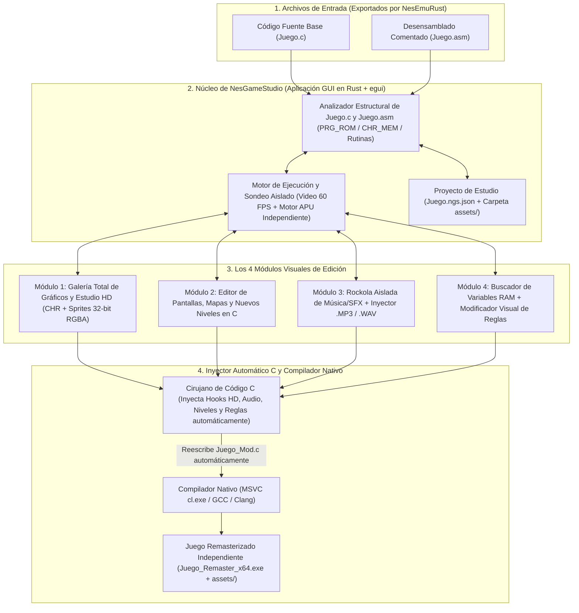
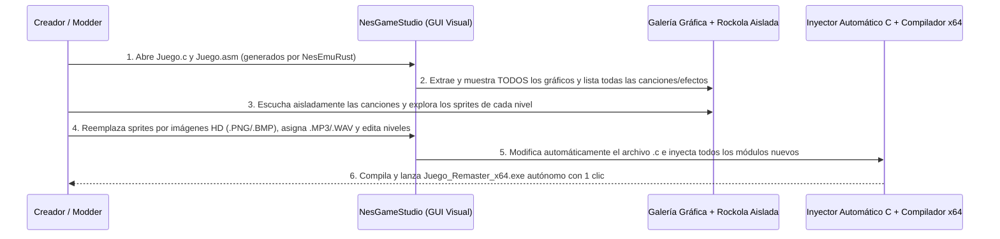

# NesGameStudio — IDE Visual de Edición, Modding y Remasterización HD para Juegos NES en C

**`NesGameStudio`** es un entorno de desarrollo visual (IDE) independiente diseñado para cargar los archivos **`.c`** y **`.asm`** generados por el recompilador estático de [**`NesEmuRust`**](https://github.com/iztaneo/NesEmuRust).

Su propósito es permitir **visualizar todos los gráficos del juego, reproducir aisladamente toda su música y efectos de sonido, editar pantallas, crear niveles nuevos y modernizar el juego con gráficos HD de 32 bits y audio `.MP3`/`.WAV`**, inyectando todos los cambios **automáticamente en el código C** sin que el usuario tenga que saber programar en C ni en ensamblador 6502.

---

## Arquitectura de Lenguaje Base: **Híbrida (Editor en Rust + Juegos Generados en C)**

| Componente | Lenguaje Base | Por qué se eligió |
| :--- | :--- | :--- |
| **IDE / Estudio Visual (`NesGameStudio`)** | **Rust** (`eframe`/`egui`, `cpal`, `image`, `serde`) | Reutiliza la PPU/APU de `NesEmuRust` para la Vista Previa a 60 FPS y la Rockola Aislada, procesa código `.c`/`.asm` masivo sin errores de memoria y ofrece una GUI rápida y moderna. |
| **Motor de los Juegos Exportados (`Target Engine`)** | **C Puro (`C99/C11`)** (`Win32` + `GDI` + `WinMM`) | Compila en **~1 segundo** con `cl.exe /O2` (`MSVC`), `gcc` o `clang`, generando ejecutables nativos `.exe` independientes y ultraligeros sin requerir librerías externas. |

---

## Arquitectura General de `NesGameStudio`

---

## Los 4 Módulos Principales

| Módulo | Función Principal | Qué Hace Automáticamente en el `.C` |
| :--- | :--- | :--- |
| **1. Galería Total de Gráficos y Widescreen (`🎨 Todos los Sprites, HD Packs & 16:9`)** | Muestra **todos los bancos gráficos del juego** decodificados en pantalla, arma los personajes completos (*metasprites*), permite reemplazarlos por imágenes **`.PNG` / `.BMP` HD de 32 bits (16.7M colores)** y activa **Widescreen 16:9 Real (`426×240` / `854×480` / `1280×720`) o 21:9 sin estirar**. | Amplía el `FRAMEBUFFER` a Widescreen/HD, renderiza los márgenes laterales desde las *NameTables* adyacentes y capas *Parallax* (centrando el HUD) e inyecta el renderizador de texturas de 32 bits en `ppu_render_scanline()`. |
| **2. Editor de Pantallas, Scrolling, Parallax y Niveles (`🗺️ Escenarios, Capas & Niveles C`)** | Lienzo visual tipo *Tiled* para editar pantallas existentes (`NameTables`), elegir modo de cámara (**Scroll Horizontal, Vertical, Auto-Scroll o Libre en 8 Direcciones para RPG/Metroidvania**), agregar **múltiples capas de profundidad (*Parallax* y *Foreground* con transparencia alfa)** o diseñar **niveles nuevos completos**. | Genera el motor de cámara multidireccional (`ngs_scroll_camera.h`), composición multicapa (`0.1x..1.5x` + *alpha blending*), estructuras de entidades (`struct CustomEntity`) y `run_custom_stage_c()` dentro del `.c`. |
| **3. Rockola Aislada, Sfxr y Estudio de Audio (`🎵 Sound Test, Piano Roll + .MP3 / .WAV`)** | **Reproduce aisladamente cada canción y efecto del juego** (*Sound Test*), incluye un **Generador de Efectos Retro en 1 clic (*Sfxr*) + *Piano Roll***, exporta pistas a `.WAV` y permite reemplazarlas por archivos **`.MP3`** o **`.WAV`**. | Inyecta el interceptor de pistas en la APU/RAM, silencia la melodía 8-bit reemplazada y conecta `mciSendStringA` (`.mp3`) y el mezclador `.wav` a `44.1 kHz`. |
| **4. Buscador RAM, Tiempo y Logros (`🔍 Variables, Rewind, Logros & Overlay`)** | Escáner en vivo para descubrir variables de `RAM`, modificar reglas con menús visuales, activar **Rebobinado en el Tiempo (*Time Rewind*) / *Bullet Time*** y definir **Logros (*Achievements*) + *Speedrun Timer***. | Escribe los `#define` legibles e inyecta el buffer circular de rebobinado (`ngs_time_control.h`) y el menú de pausa / notificaciones de logros (`ngs_overlay_ui.h`). |
| **5. Creador de Juegos Nuevos (`🚀 Motor Nativo Sin 6502, RPG/Diálogos, Cinemáticas In-Engine, IA & Consolas`)** | Funciona como un **"Mini-Unity" 2D/2.5D con bucle propio en C (cero 6502)**: incluye **Hitboxes/Colisiones**, **Iluminación Dinámica 2D y Sombras**, **Árboles de Diálogos y Modo RPG**, **Director de Escenas generadas 100% con el motor del juego (*In-Engine Cutscenes*)**, **IA de enemigos/jefes** y **Multijugador 2-4P Local/Netplay P2P**. | Mantiene `main.c` intacto, ejecuta el bucle nativo `ngs_engine_step_frame()`, traduce cada personaje/nivel/diálogo/escena a `scripts/*.h` y exporta con `engine/ngs_platform.h` hacia **Windows, Xbox Series X\|S, PlayStation 5, Switch y WebAssembly**. |
| **6. Copiloto IA Multi-Modelo y Tutor Educativo (`🤖 Gemini, Claude, OpenAI, DeepSeek y Ollama Local`)** | Panel de **Asistente IA Agéntico** integrable con **cualquier modelo en la nube o 100% gratis en local (`Ollama` / `LM Studio`)** para crear scripts `.ngscript`, diálogos RPG, cinemáticas, efectos `shader_2d` y explicar paso a paso cómo el juego se traduce a lenguaje C. | Genera código `NGScript` compacto (ahorrando tokens), lo pasa por el transpilador a `scripts/*.h` y ofrece un **Modo Profesor Interactivo** ideal para escuelas y aprendizaje de programación de videojuegos. |

---

## Flujo de Trabajo del Usuario (Sin Tocar Código)

---

## Documentación del Plan de Implementación

Consulta el diseño detallado de cada módulo, la arquitectura de la Rockola Aislada y de la Galería Completa de Gráficos, la estructura de archivos y las 5 fases de desarrollo en **[`PLAN_IMPLEMENTACION.md`](PLAN_IMPLEMENTACION.md)**.
